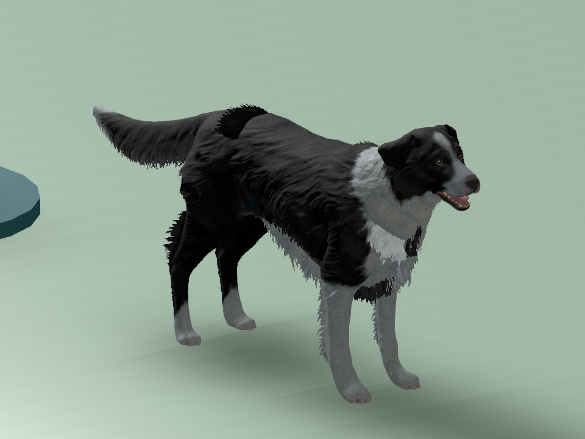
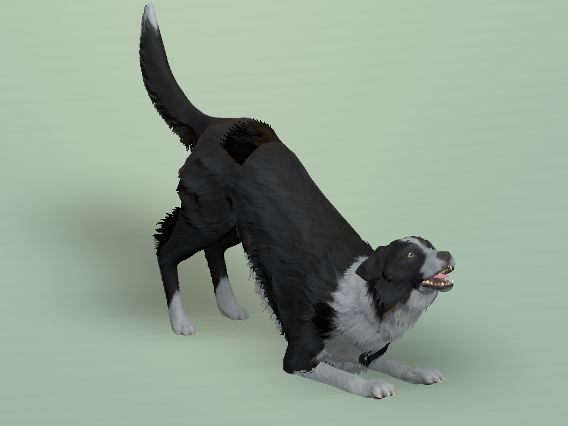
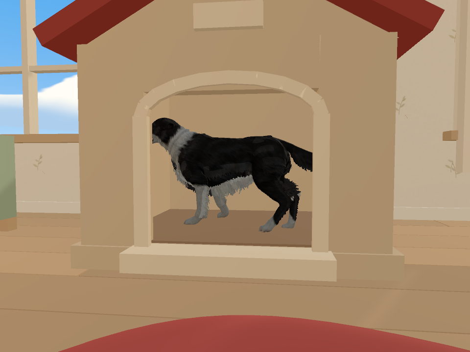
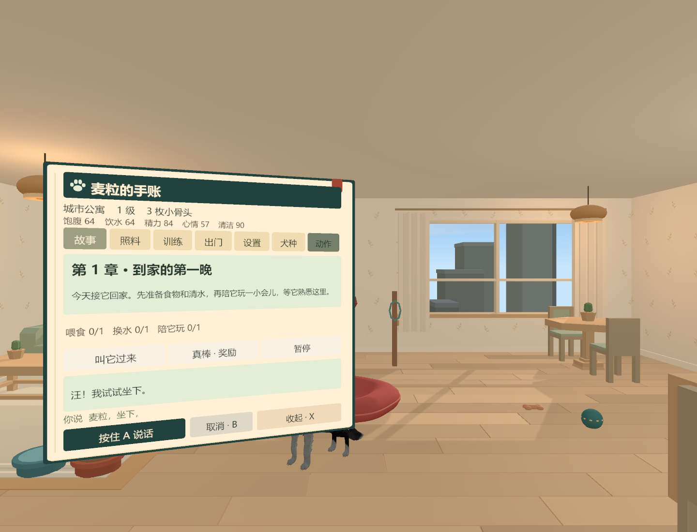
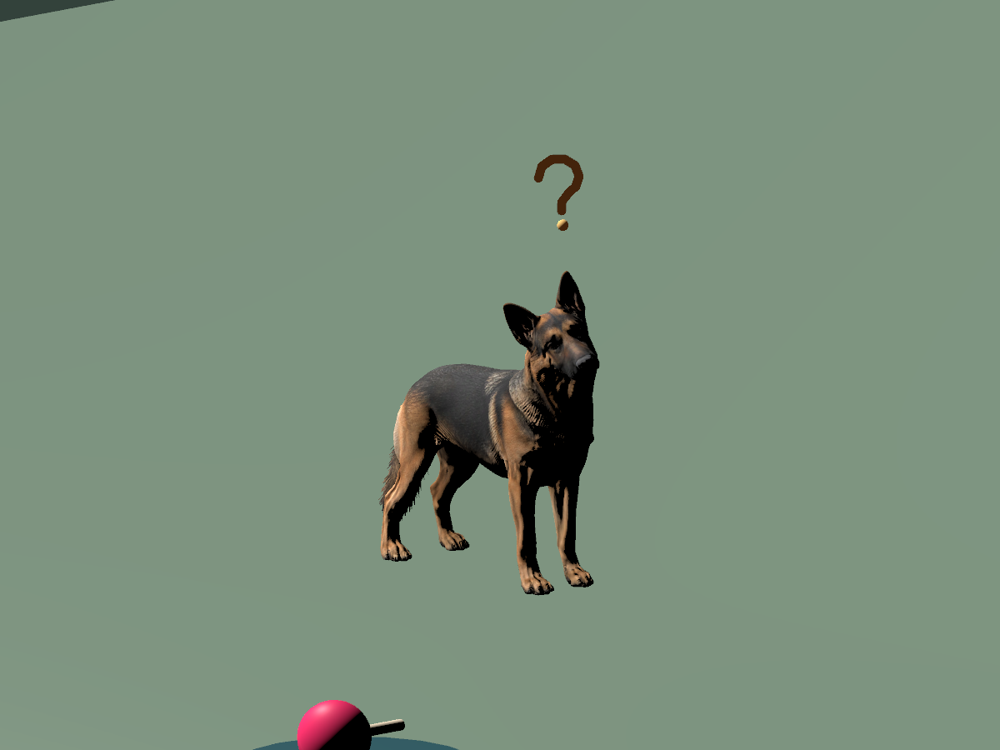
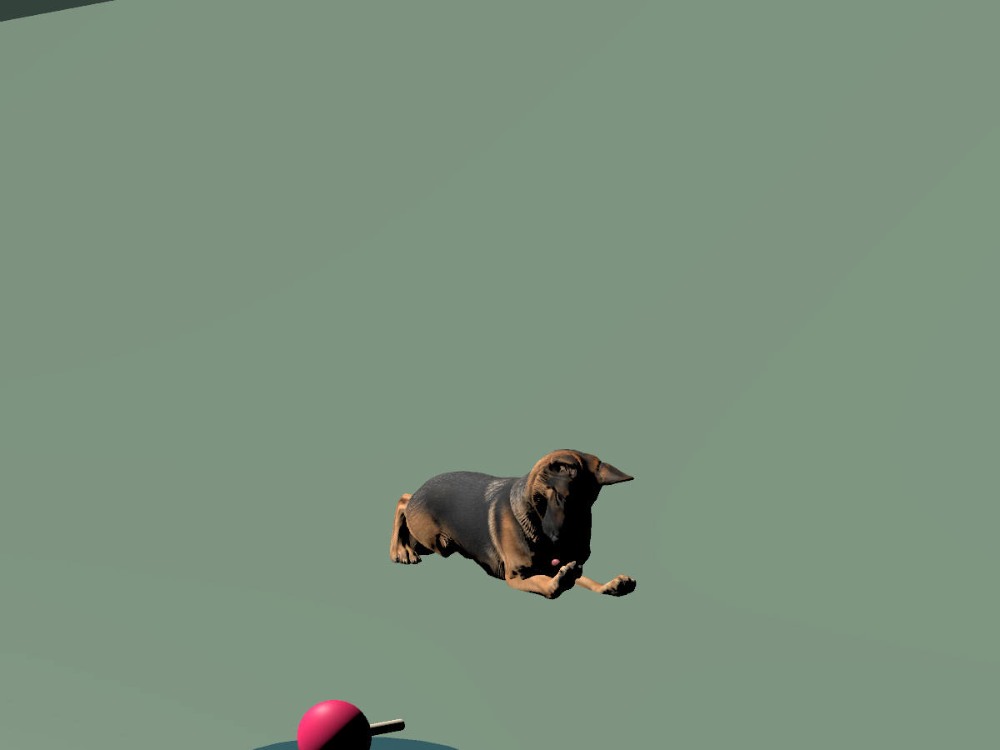
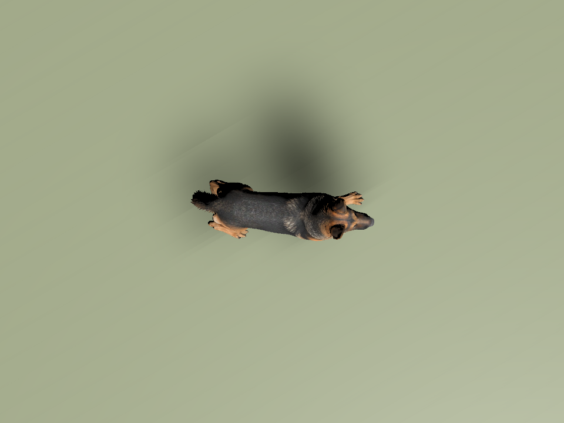
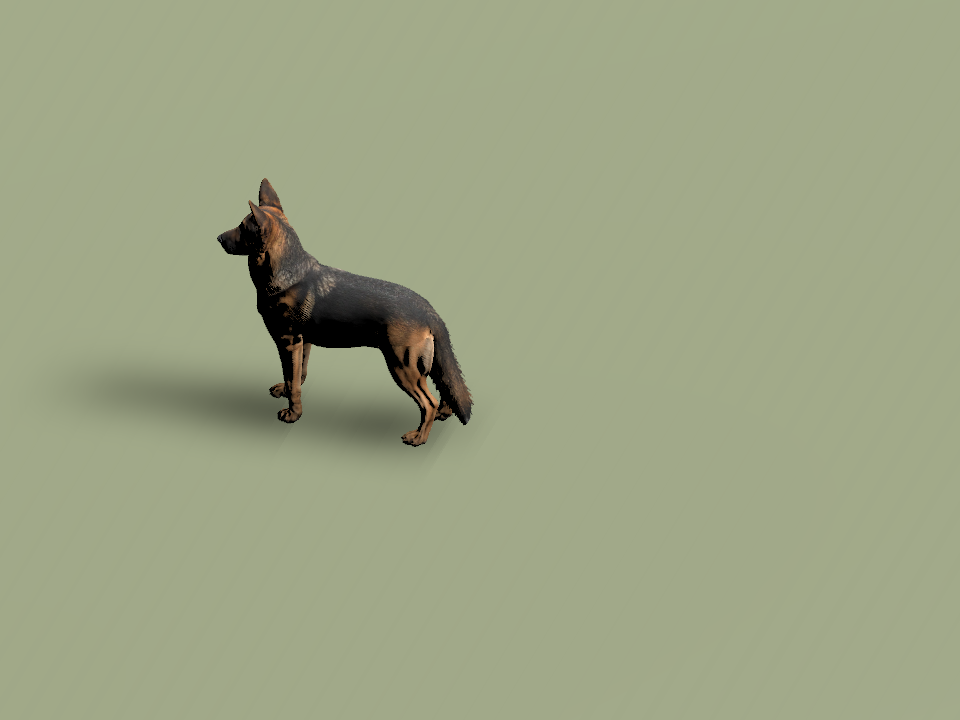

# 城市里有一只狗 · 麦粒的第一周

**5.0 · Unity 2022.3.62f3 · Dog1 VR 优先试玩**

当前版本发布到 `main`，并由 [`5.0` 标签](https://github.com/mysticaaa/COMP5140-Group7-Keep-A-Dog/tree/5.0)固定源码。它整合了 `douga-3.0` 的统一 AI 链路与体验修复，以及 main 的搬碗、扳机抓取和概率训练设计。原 `douga-3.0`、`3.1`、`3.0` 记录继续保留。

你在城市公寓里迎来麦粒。新存档默认选用原犬种列表里的边境牧羊犬，犬种页可选择柴犬等既有犬种，已有存档读取已选择的犬种。喂食、换水、散步、清理、玩耍和休息逐步组成你们的日常。完成五章照护任务，积攒小骨头，解锁街区公园和露台小屋。也可以用中文对麦粒说话，教它记住一项动作、一串口令或一个陪伴约定。

这是课程小组项目 [COMP5140-Group7-Keep-A-Dog](https://github.com/mysticaaa/COMP5140-Group7-Keep-A-Dog) 的延续。仓库保留了最早的 `SampleScene.unity`。Dog1 现已支持桌面与 Quest Link PCVR，Dog2 保留为较轻量的 VR 交互场景。



[5.0 发布说明](docs/V5.0.md) · [VR 完整走查](docs/qa/dog1-v5-vr-audit.md) · [五章玩法](#游戏设计与五章目标) · [试玩入口](#试玩入口) · [后续开发](#后续开发)

## 5.0 更新内容（2026-11-26）

- **统一的 AI 与训练入口。** 自由语言继续由 DeepSeek 输出自然回复和经过校验的动作计划，保留三个待执行槽位、五秒窗口、短期上下文与长期条件教学。六项技能从 40% 起练，实际完成与有效表扬分别强化，最高 90%。
- **可搬动的食水碗与 VR 抓取。** 狗按碗的实时位置吃喝；手持、移动、空碗、过高或不可达时不会假记完成。握把与扳机抓取、直立放碗、玩具投掷和菜单射线共用明确的占用状态。
- **追踪恢复不会误点菜单。** 拿玩具时连续丢失手柄追踪，仍保留该次扳机的占用；恢复后先消费松开动作，下一次新按才可操作菜单。
- **表扬对应当前活动。** 训练完成后若改做照护、换场景、新动作计划或开发者预览，旧训练窗口会失效，不能把这次表扬加给上一项技能或旧条件约定。
- **跨楼层不会假送达。** 靠近和取物按真实 VR Origin 地面高度检查玩家与狗是否同层。不同层会说明原因，中途变层会停止并安全放下玩具，原水平交付距离保持不变。
- **花洒开关与提示一致。** 用独立开关状态控制水流和水花，关掉时同时清空粒子；视野外暂停渲染后再次操作，也不会把仍然开启的花洒误判为关闭。

本轮按玩家流程检查 VR 菜单、移动与转向、抓取投掷、搬碗吃喝、抚摸、设施与电梯、场景切换、概率训练、语音和模型、章节存档、暂停恢复及动作预览。具体运行入口、结果、截图和模拟范围见[5.0 走查记录](docs/qa/dog1-v5-vr-audit.md)。实体 Quest 的双眼显示、追踪手感与头显麦克风仍需设备实测。

本轮 **23 个验证入口全部通过**，包括整合 81 项、跨功能流程 87 项与设施 37 项断言；真实 DeepSeek **6/6** 协议联调通过。Windows **5.0** 试玩包已重新构建，并通过无图形及带图形的启动检查。完整交互由 Unity 场景回归覆盖，启动检查不等同于实体头显验收。[本版结果汇总](docs/qa/dog1-v5-vr-results.json)

## main 整合基线（2026-11-26）

在 `douga-3.0` 的 AI 控制链路和体验修复上，合入 main 的可搬食水碗、扳机近手抓取与菜单防误触、六项技能成功率训练。概率从 40% 开始，实际完成和有效表扬分别增加 10%，最高 90%；十二秒表扬窗口按开始说话的时刻判断。普通休息、照护、陪伴和多动作计划继续使用原来的统一动作入口。

食水碗搬动后，狗会使用实际位置，持有、移动、过高或空碗均须先处理才能吃喝。模型也可选择 `eat`／`drink`，执行端会在开始和结束时检查。没有引入另一套关键词模型接口，现有动作队列、记忆、语音记录和加密配置继续保留。[本地整合说明与校验记录](docs/qa/dog1-main-integration.md)

本地十套重点回归已通过，包括 160 项训练协议校验、71 项场景整合、9 项练习守卫、7 项延迟表扬，以及原有队列、休息、条件教学、物理抓取与图形语音流程。真实 DeepSeek 六例新协议联调全部通过。实体头显仍需佩戴设备实测。

## douga-3.0 分支更新（2026-11-26）

本分支保存当前 Dog1 VR 优先试玩源码，集中完善中文语音、DeepSeek 动作控制，以及照护、任务和奖励之间的一致性。

- **自由语言交给 DeepSeek。** 语音和文字连同五项需求、场景状态、训练记忆及带标签的动作目录发送给模型；关闭按句中关键词猜动作，以及模型请求失败后的关键词动作兜底。
- **自然回复与动作计划分开。** JSON 使用 `reply`、`decision`、`actions`，支持多个有序动作。后端校验动作、目标、需求与空间条件，每步执行前重新检查；无效计划不会部分执行，合法的文字回复会保留。
- **完整输入与执行记录。** 调试窗口显示输入、请求状态、模型回包、决策来源和执行结果。每轮语音文字保存到本机，失败、取消和无人声也有记录；语音服务断线时保留本轮录音，最多尝试发送两次。
- **连接配置与错误说明。** Windows 可按当前用户和接口加密保存 API Key，重新进入 Play 后恢复；缺少密钥、401、403、429、服务不可用和超时会明确显示，不会当成“没听清”。个人密钥保存在用户数据目录。
- **短时等待队列。** 待执行项目共用三个槽位，最多等待五秒；新来的排队口令优先，同一句动作串维持顺序，过期自动取消，已经开始的动作先完成。
- **统一休息、任务和奖励。** 趴下、回狗屋、去软垫实际完成后都恢复体力并记录休息；自主休息只恢复自身状态。奖励冷却期间完成的活动仍记录任务，失败或取消不计成功。成功取回球也计入陪玩。
- **可以回应的主动邀玩。** “拜一拜”在界面中统一显示为“伏身邀玩”，成功后等待主人，并提供陪玩、安静陪伴或稍后三种回应。教学预设改称“打招呼”，旧“晚安”存档仍兼容。
- **取物与记忆修复。** 修复公寓边界导致回程提前停步、玩具接触点偏差；条件教学通过模型显式输出，实际练习成功并表扬后才保存长期约定。近期最多八条对话事件提供给模型作为短期上下文，临时聊天不长期保存。
- **本次完成才算成功。** 取物、靠近和玩耍核对本次动作的完成标记，避免沿用上次成功结果；完善 VR 遛弯取消、故事收尾，以及开发者动作预览不推进任务的说明。

本轮九套兼容回归通过，补充完成状态检查 **74 项**通过，真实 DeepSeek **七组语义与协议测试**全部通过。Unity 模拟 VR 与固定中文 WAV 测试不代表实体头显、真实手柄或真人噪声场景已经验收；旧独立 Windows 试玩程序本轮未重新打包，体验本分支需在 Unity 运行或重新构建。

[DeepSeek 协议与执行链](docs/DEEPSEEK-CONTROLLER.md) · [玩家体验走查与测试范围](docs/qa/dog1-experience-audit.md)

**当前取球范围：** VR 已有拿球和投掷，球落稳后可通过语音或陪玩入口让麦粒叼回；“扔出后自动追取”尚未接通。电脑 G 键目前用于拿起、放下。主动邀玩主要由本地状态规则触发，尚未全部交给 DeepSeek。

## 3.1 更新内容（2026-11-26）

- **主动看你。** 麦粒走到玩家身边后会先站稳，抬头、歪头看向玩家，短暂停留，再离开或接上一次邀玩。这种期待的歪头不会弹出问号，疑惑时仍有立体问号。
- **伏身邀玩。** 前爪错开向前落地，胸部下沉、后躯保持抬起，抬头看玩家。保持姿态片刻后，前爪依次收回。成功响应召回的训练进度会照常记录，随后可以自然接上邀玩。
- **正向回屋。** 麦粒朝入口向前走，进屋后放慢、转身，再面向出口趴下。离开时从出口向前走。
- **自主理毛。** 新增低频的全身抖毛，动作从头颈传到胸背和后躯，脚掌保持支撑。原来的甩头幅度收小，作为轻轻整理耳朵保留在动作目录。
- **看完再行动。** 麦粒探索时会走向实际可达的目标。玩具被挪动后，它会看向新位置，在附近有机会停下来闻看，手里的玩具放下后才可能成为探索目标。短时注视、闻嗅或邀玩的当前动作结束后，普通探索和排队的回应才接上，视线平缓回到下一目标。

| 边牧伏身邀玩 · Unity 动作测试 | 公寓狗屋内转身 · Unity 场景测试 |
| --- | --- |
|  |  |

3.1 已通过 Unity 里的默认边牧动作、原有犬种骨架、狗屋进出、场景交互、离线中文 WAV 转写、本地模拟模型和第五章存档回归，并完成统一 Windows 构建。实体 Quest、头显麦克风和线上模型安排在下轮实测。[边牧动作回归](Assets/wjy_workspace/Dog1/Editor/DogDefaultBreedValidation.cs) · [狗屋回归](Assets/wjy_workspace/Dog1/Editor/DogHouseRestValidation.cs) · [对话回归](Assets/wjy_workspace/Dog1/Editor/Dog1ConversationValidation.cs)

## 3.0 更新内容（2026-11-26）

- **一个试玩程序。** Dog1 的 Windows 构建支持 Quest Link PCVR，以及无头显时的桌面测试窗口。两种方式共用照护、训练、地图进度和存档。
- **头显手账。** 侧置故事页显示当前章节、目标和进度。麦粒邀玩时可以陪它玩球、安静待一会儿，或晚点再玩。它自己歇下后，也可以轻声回应或留出空间。[头显菜单渲染截图](docs/assets/dog1-headset-menu.png)
- **边牧与动作。** 新档默认使用原有边牧，柴犬等既有犬种仍可选，老存档保留已选犬种。调整弧线转弯和站定，加入原地注视、歪头、闻嗅和理毛等自主行为。「动作」页可逐项或连续预览 29 项动作和步态。[边牧动作验证](docs/qa/dog1-default-breed.txt) · [运动学记录与截图](docs/MOTION_RECOVERY.md)
- **三场景物理玩具。** 球和棒棒糖毛绒玩具可拿起、展示、抛出，也可让麦粒叼回。公寓有小布骨、公园有软飞盘、露台有云朵布偶。右手握把优先抓取附近玩具，落空时操作正对的门、碗或其他设施。切场景会释放已抓取的玩具。[物理交互验证](docs/qa/dog1-vr-interactions.txt)
- **语音、场景回应和记忆。** 本地中文语音接入同一套 Dog1 训练系统。可选 Agent 根据玩家、玩具和手柄的位置与遮挡，从当前可执行的动作里选择。模型服务不可用时由本地规则回应。麦粒能记住经表扬确认的毛绒玩具约定，重开存档后仍可唤回。[语音与 Agent 验证](docs/qa/dog1-vr-interactions.txt)
- **第一周叙事。** 当前可玩版接入了原有五章进度与两类主动互动。新的五章事件、四条可选支线和第七晚收尾整理成一版评审稿。[第一周故事方案](docs/DOG1-FIRST-WEEK-PROPOSAL.md)

3.0 已通过 Unity 动作、场景抓取、手柄射线模拟、中文 WAV 转写、模拟模型选择与本地回退，以及第五章重载验证。Windows 试玩程序已构建并在无头显时启动。实体 Quest 手柄、头显麦克风和线上模型待实测。[头显与语音结果](docs/qa/dog1-headset-validation.txt) · [交互与存档结果](docs/qa/dog1-vr-interactions.txt)

## 游戏设计与五章目标

游戏从城市公寓的领养第一晚开始，让玩家体验陪伴，也体验喂食、换水、清理便便和带狗出门这类反复发生的照护。每次成功照护可获得经验和小骨头。经验对应 1–5 级，每升一级额外获得 3 根小骨头，按本机日期每天也可领取 3 根。街区公园在 **2 级，花费 8 根小骨头** 后解锁，露台小屋在 **4 级，花费 28 根** 后解锁。

| 章节 | 当前任务 | 章节奖励 | 设计目的 |
| --- | --- | --- | --- |
| 1 · 到家的第一晚 | 喂食、换水、陪玩各 1 次 | 12 经验，2 根小骨头 | 熟悉新家和麦粒的基础需求 |
| 2 · 熟悉这条街 | 到访街区公园，遛弯、清理便便、训练各 1 次 | 16 经验，3 根小骨头 | 从家里走到公共空间，体验出门照护 |
| 3 · 下班后的日常 | 喂食、换水、遛弯、清理各 2 次，陪玩、休息各 1 次 | 22 经验，4 根小骨头 | 练习如何把遛狗、清洁与陪伴放进日常 |
| 4 · 它也懂你 | 训练 3 次，陪玩 2 次，休息 1 次 | 26 经验，4 根小骨头 | 通过反复练习和表扬建立默契 |
| 5 · 一起生活 | 到访露台小屋，换水、遛弯、清理、陪玩、训练、休息各 1 次 | 30 经验，6 根小骨头 | 把出门、照护、陪伴与休息连成自己的安排 |

五章按游戏内目标推进。动作实际成功才计数，进入下一章后重新累计动作次数，场景到访记录保留。第五章完成时，手账显示「第一周完成」，提示玩家继续安排与麦粒的日常。之后可以自由照护、训练和探索，继续使用已经学会的口令和约定。

**麦粒主动发起的支线。** 它伏身邀玩时，可以陪它玩球、安静陪伴或等一会儿再玩。它自己歇下时，可以轻声陪它，或给它留一个安静角落。两类回应都由玩家决定，无需选中才能推进主线。平时还可以拿起玩具与它玩，训练单个动作或最多三步的口令，也能通过实际演练和表扬，让它把棒棒糖毛绒玩具和某句约定联系起来。基本互动由本地游戏规则驱动，配置 Agent 后也可尝试用更自然的中文表达。

[第一周故事方案](docs/DOG1-FIRST-WEEK-PROPOSAL.md)记录了下一阶段要评审的五个独立事件、四条可选支线和第七晚收尾。当前试玩可从上述照护目标玩到第一周结束，下一阶段会把这些目标组织进各章事件。

## 试玩入口

从源码检出时，先按[构建与验证](#构建与验证)生成 Windows 试玩程序，再启动 `Builds/CityDog1PCVR/CityDog1PCVR.exe`。连上 Quest Link 后进入 VR，无可用头显时同一个程序显示电脑调试窗口。两个入口读取同一个 Dog1 场景与本地存档。

检出 `main` 或 `5.0` 标签，用 Unity Hub 添加仓库根目录，选择 **Unity 2022.3.62f3**，等待 Packages 导入，打开 `Assets/Scenes/Dog1.unity` 后点击 Play。已有 `douga-3.0` 分支和 `3.1` 标签仍保留各自历史版本。运行本地构建时，将可执行文件、数据目录、Unity 运行库、`SpeechService` 和模型署名留在同一目录。

**电脑测试窗口。** 左键操作手记。按住鼠标右键环顾，配合 WASD 移动。瞄准玩具按 **G** 拿起，再按 **G** 放下。按住 **V** 或手记录音按钮讲话，松开转写。Esc 可取消本轮语音，闲置时打开暂停菜单。也可在「说话」页键入。

**PCVR 操作。** 在 Windows 的 Meta Horizon Link 中设为活动 OpenXR Runtime，在 Quest 里进入 Quest Link，并在 Windows 确认头显麦克风有输入。左摇杆移动，右摇杆分段转向，手柄射线扳机松开时选中手记按钮。右手 **A** 按住讲话，松开转写。**B** 取消。在麦粒头侧缓慢移动近处手柄可触发抚摸回应。电脑窗口保留文本测试、F8 录音切换和 F9 重连。游戏在连接头显的 Windows PC 上运行。

**Dog1 头显入口。** 在 Unity 打开 `Assets/Scenes/Dog1.unity` 后点击 Play，也可以启动统一构建。左手 **X** 收起或召回侧置空间手账。首页「故事」显示当前章、目标进度，以及麦粒发起的回应选项。靠近玩具后用任一手柄握把拿起，松开可扔出；把玩具移到麦粒视野内可让它留意。空手靠近头侧缓慢移动可触发回应。手边没有玩具可抓时，看向门、食水盆、花洒或电梯控制器，按右手握把操作。电梯移动时保留头部追踪。

桌面或头显打开「动作」进入开发者模式。目录共 30 项，包括 12 个带标签的微动作、15 个全身与生活动作，以及慢走、弧线转弯、对角小跑三个演示。支持逐项播放和连播，头显可按类别筛选。「显示当前动作」可查看麦粒自己触发的闲时动作和探索目的。长距离取物和快跑需要场景中可用的道具和净空。

麦粒闲下来会自行歪头、侧头回望、闻嗅或伏身理毛。它会挑选当前可达的玩具、食水碗或软垫，走到附近停下观察。判断轨迹使用实际场景的活动范围与障碍。疑惑时用侧倾和立体问号表达。

**试玩场景回应。** 说「看看我」或「场景回应，你在看什么」。Dog1 从头骨位置观察玩家和道具的距离、朝向及遮挡，手柄可用时观察手与头部的距离。开启设置里的 Agent 模型并配置服务后，这些数据和本轮可用的动作标签会发给模型。游戏随后检查选中的动作与目标仍可用，再执行动作。未配置模型时，场景回应由本地规则选择。普通探索和自发微动作也由本地程序控制。

麦粒伏身邀玩后，可在故事页选「陪它玩球」「陪它安静一会儿」或「等一会儿再玩」，也可以问「你想玩球还是安静一会儿？」。本地规则根据体力、饮水和玩具状态回应；启用模型后，可在可执行的选项内作选择。它自己歇下时也可以选择轻声陪它或给它留空间。

Unity 配置通过共享的 `Dog2XrSetup.Configure` 设置 Standalone OpenXR、Touch/Touch Plus 手柄和 Single Pass Instanced，关闭自动启动，由场景在输入动作注册后启动。Dog1 使用独立的 XR 相机；无头显时不会接管桌面相机。设备稍后就绪可自动恢复，也可在设置中重连或按 F9。支持范围是 **Windows + Quest Link/Air Link 的 PCVR**，尚未提供 Quest 独立 APK。



## 场景与道具

三个场景都有可抓取球和棒棒糖毛绒玩具。公寓另有小布骨，公园有软飞盘，露台有云朵布偶。共用玩具可以让麦粒叼回，新增场景玩具可以抓、抛和展示。家具和建筑继续提供碰撞，场景设施按各自的用途操作。玩具由 Unity 原创几何构成。 [KONG 毛绒玩具参考](https://www.kongcompany.com/dog-toys/plush/) · [Petmate 软飞盘参考](https://www.petmate.com/products/chuckit-amphibious-zipflight)

## 本版动作调试

转弯沿可通行的弧线继续走。胸腰、骨盆和肩胛分担幅度，脚掌分别在身体两侧落地。停下时逐爪回到自然站位。默认边牧已独立通过弧线行走与站定检查。德牧的双向急转对照中，落脚从 49 次降到 44 次。连续弯道和急转均未测到小于 5.5 厘米的摆步，停步后四足连续支撑 33 个采样帧。双向急转的最大脚滑由 6.2 厘米增到 11.6 厘米，连续弯道最大 10.8 厘米。滑移仍需调校。[步态结果](docs/qa/dog1-curved-walk.txt)

安静时可自己转头、歪头、竖耳、轻转单耳、侧身探看、抬鼻闻、在人与玩具之间换视线、轻轻整理耳朵、抖毛、舔前爪、回头和贴地嗅闻。它走向一个实际可达的场景目标，途中遇到附近可见的玩家会短暂扭头，抵达后停步观察。抚摸反馈使用探头和摇尾，躯干翻滚留待验证。

开发者预览独立于训练和奖励。设置可以显示世界空间骨链，方便对照头颈、胸腰与四足接触。骨架恢复过程、论文和 Stay 参考资料见[犬类骨架恢复与动作研究](docs/MOTION_RECOVERY.md)。犬只自我理毛中有舔舐行为，本项目把它写成短时、低频、受姿态约束的动作。[犬类行为观察研究](https://www.mdpi.com/2076-2615/6/11/64)

<table>
<tr><td></td><td></td></tr>
<tr><td></td><td></td></tr>
</table>

`DogMotionRecoveryValidation.Run` 检查 15 种全身动作、12 种微动作、可见角度、脚掌支撑、取物、自动探索和 11 种犬种的骨架映射。[3.1 动作回归用例](Assets/wjy_workspace/Dog1/Editor/DogMotionRecoveryValidation.cs) · [3.0 动作验证记录](docs/qa/dog1-action-validation.txt)

## 中文语音与 Agent

2026-11-26 体验走查统一了休息、陪玩、训练任务和奖励的记录：趴下、回狗屋和去软垫完成后都会恢复体力并记录休息；自主休息只恢复自身状态。奖励冷却期间的真实活动仍可推进任务，不重复发奖。“拜一拜”在界面中统一为“伏身邀玩”，完成后可以回应陪玩、安静或稍后。教学预设改称“打招呼”，旧“晚安”存档仍兼容。另修复取物回程在公寓边界提前停步、条件教学、近期对话上下文和 VR 遛弯取消入口。[走查范围与验证记录](docs/qa/dog1-experience-audit.md)

**首次使用麦克风。** Windows 安装 Python 3.10–3.12。在本地构建旁的 `SpeechService` 目录运行下列命令。用 Unity 编辑器时，安装目录为 `Assets/wjy_workspace/Dog2/SpeechService`。

```powershell
.\Setup.ps1
```

首次安装下载 Python 依赖和 Whisper **small** 多语言模型。Dog1 在进入场景时预热服务，减少第一句的启动等待；也可运行 `Start.ps1` 手动启动。若 Python 不在 PATH，可使用 `-PythonPath` 指定 Python 可执行文件。默认语音地址为 `http://127.0.0.1:18765/transcribe`，程序通过健康接口校验服务标识。安装完成后可以离线转写，音频留在这台电脑。

设置页可切换并记住麦克风。桌面默认使用系统输入，只有进入实际 XR 会话后才自动优先 Quest/Oculus 麦克风；手动选择始终优先。录音按设备支持的采样率启动，显示输入音量，松开按键后保留 180ms 句尾。服务进行直流偏移去除、有限音量增益、Silero 人声检测、中文词汇提示和低置信度过滤。实现依据：[faster-whisper 官方说明](https://github.com/SYSTRAN/faster-whisper)、[转写参数](https://github.com/SYSTRAN/faster-whisper/blob/master/faster_whisper/transcribe.py)、[VAD 参数](https://github.com/SYSTRAN/faster-whisper/blob/master/faster_whisper/vad.py)。

本机实测新版 ONNX Runtime 1.31.1 在加载时发生原生访问冲突，因此将语音环境依赖固定到已验证的 **1.20.1**；`Setup.ps1` 会安装此版本，服务启动时先预热 VAD 再报告就绪。small 优先准确率，CPU 转写仍需数秒；需要较快响应时可安装 base 并在启动游戏/服务前选择它：

```powershell
.\Setup.ps1 -Model base
$env:CITYDOG_WHISPER_MODEL = 'base'
.\Start.ps1
```

默认 `auto` 优先使用已安装的 small，没有 small 时兼容原来的 base。语音结果仍需经原有 DogAgent 的动作白名单与执行结果检查，静音不会发送给 Agent。

**训练与记忆。** 明确的训练按钮仍可在本地练习，第一次给不熟悉的口令时麦粒可能犹豫，做成以后可以表扬。自由语音和文字统一交给 DeepSeek 理解；不再按句中关键词猜动作，模型服务失败也不会按关键词自动执行。桌面与 PCVR 在同一 Windows 用户下使用相同的口令记忆，已确认的命名动作串会作为上下文提供给模型。

**DeepSeek 控制链路。** 在运行时启用模型，并填写 Chat Completions 地址、模型名和临时凭据。转写文字连同五项需求、场景条件、训练记忆和带标签的动作目录交给模型。返回 JSON 将自然回复 `reply` 与 `decision`、`actions` 分开：模型从当前可执行的目录中选择动作，也可解释拒绝或仅聊天。后端逐项核对动作与目标、需求和空间条件；不合格的计划不会执行，文字回复会保留，校验原因可在「说话 → DeepSeek 调试」查看。密钥支持当前会话使用或本机加密保存。[协议和测试说明](docs/DEEPSEEK-CONTROLLER.md)

**短时等待。** 所有待执行项目共用 **3 个位置**，等待最多 **5 秒**。新来的排队口令优先，同一句「先 A 再 B」仍按指定顺序完成。等待截止时间不会因为模型回复而重置；过期项目自动取消，当前正在播放的动作会完成。调试窗口会列出等待项、剩余时间和执行结果。

**连接配置与报错。** Windows 设置页的「加密保存到本机」按当前用户和接口保存密钥，重新进入 Play 或重开 Unity 后自动加载并启用模型。密文存放在用户数据目录，项目文件不保存密钥；隔离回归不会读取个人凭据。官方接口缺少密钥时会在本地拦截，401 会说明鉴权失败，403、429、服务不可用和网络超时也会显示对应原因，并保持空动作。

## 构建与验证

在仓库根目录，将 `$Unity` 设为本机 **Unity 2022.3.62f3** 的 `Unity.exe`，构建统一输出 `Builds/CityDog1PCVR`。

```powershell
& $Unity -batchmode -projectPath (Get-Location).Path -buildTarget Win64 -executeMethod Dog1DemoValidation.BuildDog1PcVr -logFile dog1-pcvr-build.log
```

Unity Play 模式已覆盖步态与停步、取物、自发动作、定点探索、PCVR 空间手记、中文转写及 Agent 动作链。使用本地模拟模型响应验证了带标签的请求、收到选择后的动作播放与无效选择的拒绝，本分支另完成真实 DeepSeek 七例语义与协议联调。Quest 双眼显示、实体手柄、头显麦克风和真人语音噪声仍需实测。[本轮测试范围](docs/qa/dog1-experience-audit.md) · [历史头显 UI 与 Agent 测试记录](docs/qa/dog1-headset-validation.txt)

Dog1 新增 `Dog1HeadsetValidation.Run` 集成验证：独立相机和桌面回退、真实几何射线按下/松开、训练调用、照料/出门/犬种入口、暂停状态下继续，以及本地中文 WAV 经 Unity HTTP 转写后进入同一个 Dog1 Agent。使用隔离的测试存档；`SpeechService/Tests~/sit.wav` 是 Windows 中文合成声音生成的固定样本，不是用户录音。输出默认在 `Logs/Dog1HeadsetValidation`，也可通过 `CITYDOG_QA_OUTPUT` 指定。

```powershell
& $Unity -batchmode -projectPath (Get-Location).Path -executeMethod Dog1HeadsetValidation.Run -logFile dog1-headset-validation.log
```

2026-11-25 合成语音回归：六句普通中文、其中一句降低到原音量的 1.5%、静音和固定随机噪声共九例。新方案识别出低音量的「麦粒，坐下」，将旧版「踏下」「抬起右招」分别修正为「趴下」「抬起右爪」，静音和噪声均返回空文本。该结果仅证明这些固定样本的改善，不代表真实口音、房间噪声或头显麦克风的总体准确率；后续仍需佩戴设备实测。

[v1.0 更新与验证](docs/V1.0.md) · [桌面玩法细节](Assets/wjy_workspace/Dog1/README.md) · [语音与 Quest Link 说明](Assets/wjy_workspace/Dog2/README.md) · [游戏策划](CITY-DOG-ROADMAP.md) · [语音与 XR 路线](CITY-DOG-XR-PLAN.md)

## 后续开发

接下来先在实体 Quest 上验证交互并完成动作、道具回归，再落地五章叙事，随后进行真实语音与线上 Agent 验证和 Steam Demo 准备。每阶段的前置条件、交付项和验收标准见[后续开发计划](docs/DOG1-DEVELOPMENT-PLAN.md)。

## 署名与资产

德牧原始骨架、FBX 和 PBR 贴图来自 **3dskillup.art / Francesco Saviano**，使用 CC BY 4.0。项目在原资产上制作了 Unity 程序化动作、姿态修正和尾部毛发层。分发包含该资产的工程或构建时请保留署名文件。 [模型来源](https://3dskillup.art/free-assets/german-shepherd/) · [CC BY 4.0](https://creativecommons.org/licenses/by/4.0/) · [仓库署名文件](Assets/wjy_workspace/Dog1/ThirdParty/ATTRIBUTION.md)
