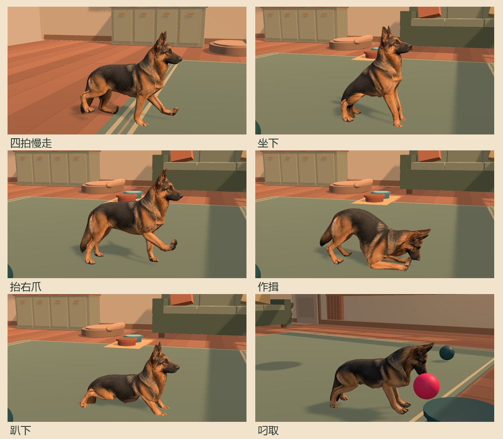
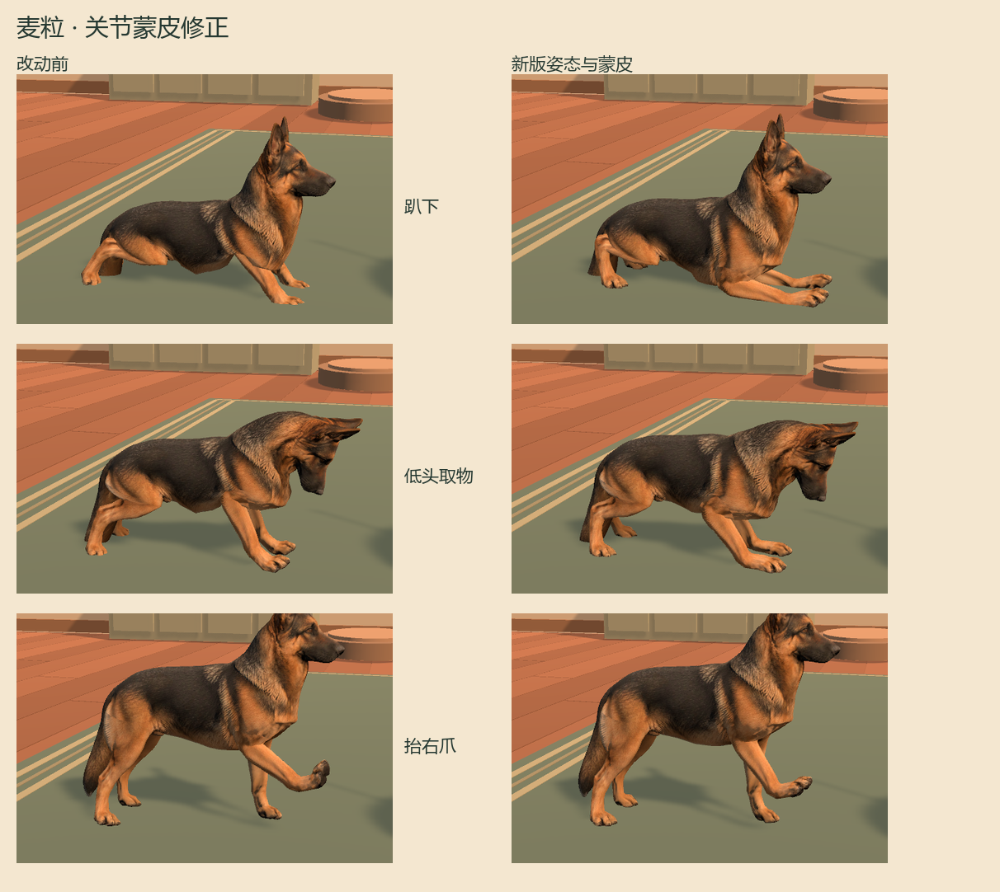
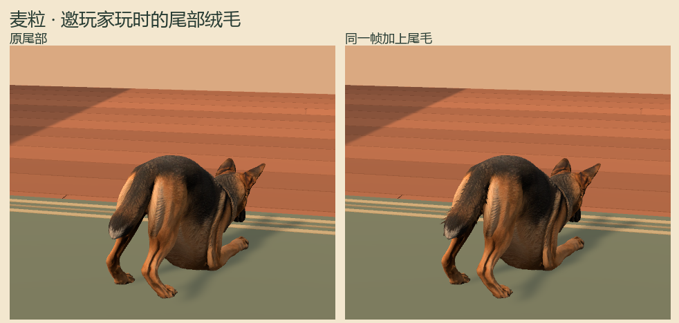
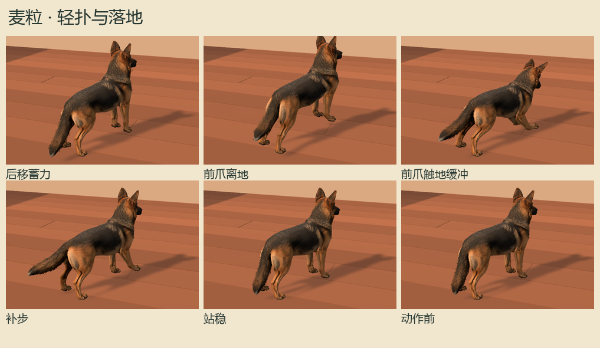
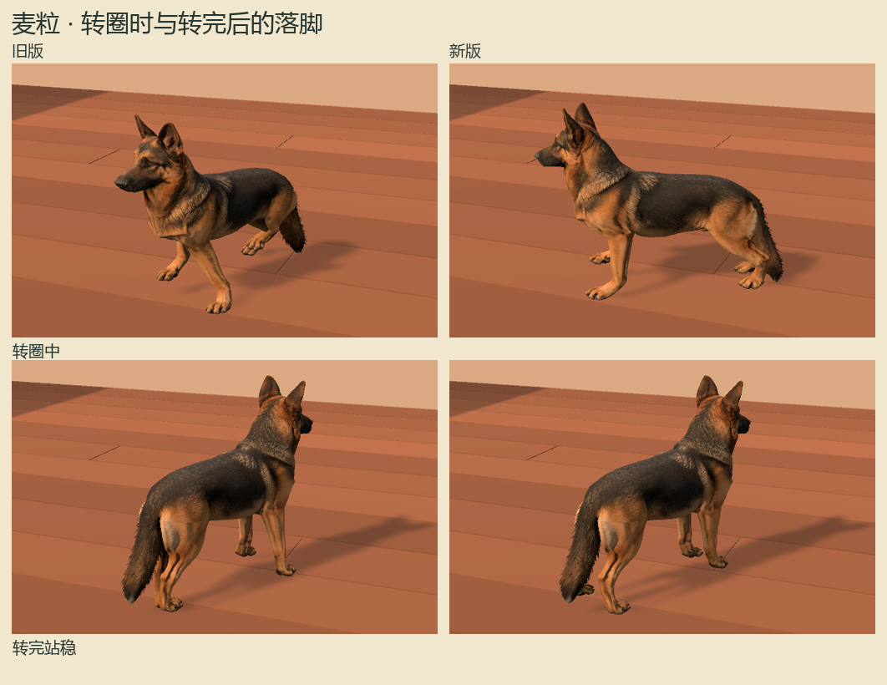

# 城市里有一只狗 · 麦粒的第一周

**v1.0 · Unity 2022.3.62f3 · Windows 桌面与 Quest Link PCVR**

你在城市公寓里迎来一只叫麦粒的德牧。喂食、换水、散步、清理、玩耍和休息逐步组成你们的日常。完成五章照护任务，积攒小骨头，解锁街区公园和露台小屋。也可以用中文对麦粒说话，教它记住一项动作、一串口令或一个陪伴约定。

这是课程小组项目 [COMP5140-Group7-Keep-A-Dog](https://github.com/mysticaaa/COMP5140-Group7-Keep-A-Dog) 的延续。仓库保留了最早的 `SampleScene.unity`，新版桌面与 PCVR 分别从 Dog1、Dog2 进入。

[开始试玩](#选择试玩方式) · [运动学研究与迭代](#麦粒的运动学研究与迭代) · [构建与验证](#构建与验证)

## 选择试玩方式

| 模式 | Unity 场景 | 本地构建入口 | 内容 |
| --- | --- | --- | --- |
| Windows 桌面 | `Assets/Scenes/Dog1.unity` | `Builds/CityDogVoice/CityDog.exe` | 五章成长、三个地点、照护、中文语音与训练 |
| Quest Link PCVR | `Assets/Scenes/Dog2.unity` | `Builds/CityDogPCVR/CityDogPCVR.exe` | 公寓、空间手记、手柄、语音、抚摸和训练 |

从 GitHub 选择 `release/v1.0` 分支获取源码，再用 Unity Hub 添加仓库根目录，选择 **Unity 2022.3.62f3**，等待 Packages 导入，打开对应场景后点击 Play。运行本地构建时，将可执行文件、数据目录、Unity 运行库、`SpeechService` 和模型署名留在同一目录。

**桌面操作。** 左键操作手记。按住鼠标右键环顾，配合 WASD 移动。按住 **V** 或手记录音按钮讲话，松开转写。Esc 可取消本轮语音，闲置时打开暂停菜单。也可在「说话」页键入。

**PCVR 操作。** 在 Windows 的 Meta Horizon Link 中设为活动 OpenXR Runtime，在 Quest 里进入 Quest Link，并在 Windows 确认头显麦克风有输入。左摇杆移动，右摇杆分段转向，手柄射线扳机松开时选中手记按钮。右手 **A** 按住讲话，松开转写。**B** 取消。在麦粒头侧缓慢移动近处手柄可触发抚摸回应。电脑窗口保留文本测试、F8 录音切换和 F9 重连。游戏在连接头显的 Windows PC 上运行。

## 中文语音与 Agent

**首次使用麦克风。** Windows 安装 Python 3.10–3.12。在本地构建旁的 `SpeechService` 目录运行下列命令。用 Unity 编辑器时，安装目录为 `Assets/wjy_workspace/Dog2/SpeechService`。

```powershell
.\Setup.ps1
```

首次安装下载 Python 依赖和 Whisper base 模型。安装完成后，游戏会在开始录音时尝试启动本机服务，也可运行 `Start.ps1` 手动启动。若 Python 不在 PATH，可使用 `-PythonPath` 指定 Python 可执行文件。默认语音服务接收按键录制的音频，地址为 `http://127.0.0.1:8765/transcribe`。使用本机服务时，安装完成后可以离线转写，音频留在这台电脑。

**本地训练。** 语音转写和文本进入同一套 DogAgent。第一次给不熟悉的口令时麦粒可能犹豫，等它做成以后再表扬。试着说「晚安：坐下、抬右爪、拜一拜」，动作完成后表扬，下次只说「晚安」。也可以教它「我心情不好的时候，给我叼来一颗棒棒糖」，完成并表扬后，重开游戏再说「我心情不好」。可练习「轻扑一下」和「闻一闻」。桌面与 PCVR 在同一 Windows 用户下使用相同的口令记忆。

**可选语言模型。** 基本照护、训练、中文转写和存档无需 API Key。若需要处理更自由的措辞，可在运行时开启兼容模型，填写完整 Chat Completions 地址、模型名和该服务所需的临时凭据。本机 Ollama 可使用 `http://127.0.0.1:11434/v1/chat/completions`。仅在需要模型判断时发送当前文本与有限的训练摘要。动作与目标由游戏检查，动作串最多三步。不要在场景、源码或 Git 中保存真实密钥。

## 麦粒的运动学研究与迭代

以下按开发顺序记录问题、研究依据、实现和 Unity 验收。截图和动图来自当时的 Unity 场景。研究用于判断关节、步态和行为应该如何变化，速度、角度和时间均在当前德牧模型上调校。

### 1. 骨架关键点、四拍步态与基础动作

早期原型会响应坐下、趴下和叼取，但移动时支撑爪容易随身体滑动，不同动作的重心变化也不明显。参考 StanfordExtra 的犬类标注，项目直接使用德牧模型的三维骨骼变换。前腿跟踪肩胛、肩、肘、腕、趾，后腿跟踪髋、膝、跗、爪，躯干跟踪骨盆、腰、胸和颈。头骨下另设吻部锚点用于叼取。桌面「设置 → 显示骨骼关键点」可观察关节与爪子的支撑状态。 [StanfordExtra 原论文](https://arxiv.org/abs/2007.11110) · [项目关键点代码](Assets/wjy_workspace/Dog1/DogKeypointOverlay.cs)

犬类地面慢走研究记录的四拍顺序是左后、左前、右后、右前，或从另一侧开始的镜像顺序。项目给落地爪保留世界坐标目标，让抬起的爪沿弧线去下一个落点，再用逆运动学转动已有骨链。坐下时前爪支撑、后躯下沉，抬爪时给对侧留出承重空间，伏身时胸部降到骨盆以下。叼取则检查吻部距离，成功后道具随吻部移动。 [犬类地面步态研究](https://journals.plos.org/plosone/article?id=10.1371/journal.pone.0133936) · [动作控制代码](Assets/wjy_workspace/Dog1/DogCompanion.cs)



*四拍步态和基础训练动作建立时的公寓场景截图。* [四拍慢走动图](docs/assets/walk-early.gif)

### 2. 修关节褶皱，试验现成犬只动作

趴下和低头取物时，前肢、胸口和胯部的网格容易挤扁。调整姿态后，为坐、趴、伏身、抬爪和低头取物烘焙了五个姿态修形，运行时按动作权重混合。趴下的烘焙记录中，面积小于绑定姿态一半的三角形从 **1,169 降至 1,081**。部分姿态仍有拉伸，例如伏身时面积超过绑定姿态两倍的三角形从 **18 增至 36**。 [姿态修形](Assets/wjy_workspace/Dog1/DogCoatCorrectives.cs) · [网格烘焙脚本](Assets/wjy_workspace/Dog1/Editor/DogCoatBaker.cs)



*左列是修正前，右列同时应用了新版姿态和蒙皮。*

德牧与拉布拉多的对比研究发现背线和后肢运动存在差异。独立 Unity 工程中试播 FeralMotion 拉布拉多的走、坐、趴，每段动画在原骨架都匹配 **48/48** 条绑定路径，直接播放到德牧为 **0/48**。手工映射 **29 根骨骼**的旋转后，德牧骨长保持稳定，但趴下时左前爪测点最低仍离地约 **24.9 厘米**，原拉布拉多约 **2.3 厘米**。复用这类动作还需要重映射重心位移并重新做接地。V1.0 沿用德牧的程序化动作。 [两犬种的生物力学对比](https://journals.plos.org/plosone/article?id=10.1371/journal.pone.0239832) · [试验资源](https://feralmotion.itch.io/labrador)

### 3. 从摇尾到邀玩和轻扑

三维摇尾轨迹研究记录了个体差异和情境变化。麦粒平静时自然垂尾，走路时轻摆。邀玩、获得有效表扬或回应抚摸时，尾根先摆，四段尾骨依次跟随，短摇尾约 **1.8 秒**，幅度逐渐衰减。根据德牧垂尾和尾下长毛的外形特征，沿原贴图和蒙皮权重烘焙 **320 簇**尾毛。调校时记录到伏身摇尾的尾尖骨测点左右摆幅约 **24.7 厘米**，抚摸时四爪最大偏移约 **1 毫米**。 [犬尾三维轨迹研究](https://pubmed.ncbi.nlm.nih.gov/35942104/) · [FCI 德牧犬种标准](https://www.fci.be/nomenclature/Standards/166g01-en.pdf) · [尾部绒毛烘焙脚本](Assets/wjy_workspace/Dog1/Editor/DogTailFurBaker.cs)



[Unity 邀玩与摇尾动图](docs/assets/tail-wag.gif)

成年犬研究观察到伏身常出现在玩耍暂停后，双方随后恢复互动。麦粒会朝看着它的玩家伏低前身、摇尾并等回应，玩家可以陪玩或表扬。旧口令「拜一拜」仍可用。轻扑参考幼犬物体玩耍行为表，分为后移蓄力、抬前爪、触地缓冲和补步。Unity 测得双前爪各抬约 **9 厘米**，后爪持续支撑。公园短冲需有净空，测试走过 **2.4 米**弧线，玩家进入路径后停止前进。 [成年犬伏身邀玩研究](https://pubmed.ncbi.nlm.nih.gov/26923096/) · [幼犬物体玩耍行为表](https://www.mdpi.com/2076-2615/13/8/1371) · [互动动作代码](Assets/wjy_workspace/Dog1/DogCompanion.Play.cs)



### 4. 重做口令转圈的错步和收脚

旧版能转满一圈，但有些爪子仍留在旧落点，前后腿容易越过身体中线。德牧动态 X 光研究记录了步行和小跑中骨盆与腰椎的相对运动。项目让头颈和肩胸先带转向，骨盆稍后跟进。口令转圈为四爪安排错开的弧形落点，结束时依次回到自然站位。固定机位的两次试验都完成 **359.99°**，各采样 **170 帧**，出现爪子越过身体中线的帧数从 **109 降到 0**，后爪间距从 **1.2 恢复到 17.0 厘米**。 [德牧骨盆与腰椎动态 X 光研究](https://www.frontiersin.org/journals/veterinary-science/articles/10.3389/fvets.2021.709966/full) · [转圈与轻扑验收脚本](Assets/wjy_workspace/Dog1/Editor/DogPlayValidation.cs)



### 5. 分开慢走、小跑和普通转弯

旧版快走主要靠加快同一套脚步。犬类自由运动研究记录了步态切换时对角肢体相位的变化。V1.0 将公寓默认散步速度调到约 **0.62 米/秒**，延长四拍慢走的支撑时间，快档采用对角小跑。最初的相位过渡造成了较长的跨步和滑移，随后保留两只后爪的相位，仅逐步调整前爪相位，并缩短起步步幅。 [犬自由运动的步态转换](https://pubmed.ncbi.nlm.nih.gov/11721550/) · [德牧地面步态研究](https://pmc.ncbi.nlm.nih.gov/articles/PMC7158696/)

普通急转先减速，预测旧支撑点即将超出可达范围时，让那只爪提前迈步。停步时先让悬空的爪落地，再一次补一只，其余三只保持支撑。下表来自固定 Unity 路线。对角同步次数统计自直行的稳定区间。 [犬类转弯运动学](https://pubmed.ncbi.nlm.nih.gov/36268759/) · [急转落点](Assets/wjy_workspace/Dog1/DogCompanion.TurnContact.cs) · [停步收脚](Assets/wjy_workspace/Dog1/DogCompanion.Stance.cs)

| 测试项 | 旧版基线 | V1.0 |
| --- | --- | --- |
| 左右急转后爪子距正常站位的最大偏差 | 22.2 厘米 | 0.0 厘米（日志精度） |
| 左右急转时支撑爪最大滑移 | 18.2 厘米 | 13.3 厘米 |
| 3.6 米慢档 | 平均 0.55 米/秒 | 平均 0.54 米/秒，0/26 次对角同步 |
| 3.6 米快档 | 平均 1.55 米/秒，沿用四拍 | 平均 1.26 米/秒，14/15 次对角同步 |

急转停稳后采样的 **33 帧**均为四足着地，未测到持续挪脚。直线起步的最大滑移分别为慢走 **4.4 厘米**、小跑 **9.2 厘米**，高于同一路线旧版的 **1.3** 和 **1.1 厘米**。当前快档的范围是小跑，复杂地面和 Quest 实机仍待验收。 [步态与急转验收脚本](Assets/wjy_workspace/Dog1/Editor/DogGaitValidation.cs)


*同一条左右急转路线，左图为转弯中，右图为停稳后。*

### 复现测试和截图

从仓库根目录执行以下 PowerShell。先关闭占用此项目的 Unity 编辑器窗口，将 `$Unity` 设为本机 Unity 2022.3.62f3 的 `Unity.exe` 路径。截图需要图形设备。

```powershell
$project = (Get-Location).Path
$captures = Join-Path $project 'Builds/MotionReview'
New-Item -ItemType Directory -Path $captures -Force | Out-Null
$env:CITY_DOG_GAIT_CAPTURES = $captures
& $Unity -batchmode -projectPath $project -executeMethod DogGaitValidation.Run -logFile (Join-Path $captures 'gait.log')
```

日志出现 `DOG_GAIT_OK` 表示步态和转弯验收通过。用相同方式运行 `DogMotionValidation.Run`、`DogTailValidation.Run` 和 `DogPlayValidation.Run`，分别设置 `CITY_DOG_MOTION_CAPTURES`、`CITY_DOG_TAIL_CAPTURES` 和 `CITY_DOG_PLAY_CAPTURES` 可保存其他动作截图。 [V1.0 构建与全部验收命令](docs/V1.0.md#构建与复验)

## 构建与验证

在仓库根目录，将 `$Unity` 设为本机 **Unity 2022.3.62f3** 的 `Unity.exe`，选择对应命令。命令生成上表列出的目录。

```powershell
& $Unity -batchmode -projectPath (Get-Location).Path -buildTarget Win64 -executeMethod Dog1DemoValidation.BuildWindows -logFile desktop-build.log
& $Unity -batchmode -projectPath (Get-Location).Path -buildTarget Win64 -executeMethod Dog1DemoValidation.BuildPcVr -logFile pcvr-build.log
```

Unity Play 模式已覆盖照护和解锁、动作串保存重载、步态与停步、取物，以及 PCVR 空间手记、转写回调和 Agent 动作链。中文转写使用合成语音样本另行验证。Quest 双眼显示、实体手柄和头显麦克风仍需接入设备实测。当前公开的使用说明面向 Windows 桌面和 Quest Link，Quest 独立 APK 属于后续目标。

[v1.0 更新与验证](docs/V1.0.md) · [桌面玩法细节](Assets/wjy_workspace/Dog1/README.md) · [语音与 Quest Link 说明](Assets/wjy_workspace/Dog2/README.md) · [游戏策划](CITY-DOG-ROADMAP.md) · [语音与 XR 路线](CITY-DOG-XR-PLAN.md)

## 署名与资产

德牧原始骨架、FBX 和 PBR 贴图来自 **3dskillup.art / Francesco Saviano**，使用 CC BY 4.0。项目在原资产上制作了 Unity 程序化动作、姿态修正和尾部毛发层。分发包含该资产的工程或构建时请保留署名文件。 [模型来源](https://3dskillup.art/free-assets/german-shepherd/) · [CC BY 4.0](https://creativecommons.org/licenses/by/4.0/) · [仓库署名文件](Assets/wjy_workspace/Dog1/ThirdParty/ATTRIBUTION.md)
