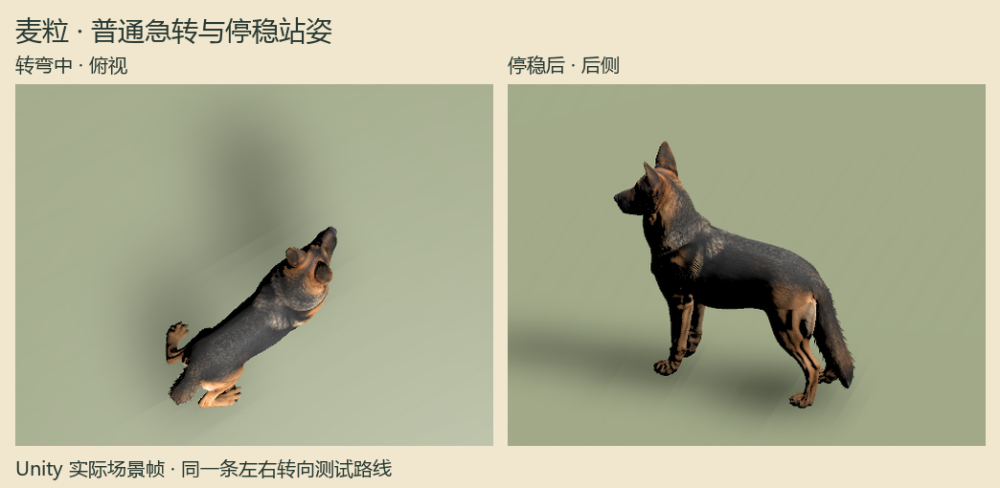

# 城市里有一只狗 · 麦粒的第一周

**v1.0 · Unity 2022.3.62f3 · Windows 桌面与 Quest Link PCVR**

你在城市公寓里迎来一只叫麦粒的德牧。喂食、换水、散步、清理、玩耍和休息逐步组成你们的日常。完成五章照护任务，积攒小骨头，解锁街区公园和露台小屋。也可以用中文对麦粒说话，教它记住一项动作、一串口令或一个陪伴约定。

这是课程小组项目 [COMP5140-Group7-Keep-A-Dog](https://github.com/mysticaaa/COMP5140-Group7-Keep-A-Dog) 的延续。仓库保留了最早的 `SampleScene.unity`，新版桌面与 PCVR 分别从 Dog1、Dog2 进入。



## 选择试玩方式

| 模式 | Unity 场景 | 本地构建入口 | 内容 |
| --- | --- | --- | --- |
| Windows 桌面 | `Assets/Scenes/Dog1.unity` | `Builds/CityDogVoice/CityDog.exe` | 五章成长、三个地点、照护、中文语音与训练 |
| Quest Link PCVR | `Assets/Scenes/Dog2.unity` | `Builds/CityDogPCVR/CityDogPCVR.exe` | 公寓、空间手记、手柄、语音、抚摸和训练 |

从 GitHub 选择 `release/v1.0` 分支获取源码，再用 Unity Hub 添加仓库根目录，选择 **Unity 2022.3.62f3**，等待 Packages 导入，打开对应场景后点击 Play。运行本地构建时，将可执行文件、数据目录、Unity 运行库、`SpeechService` 和模型署名留在同一目录。

**桌面操作。** 左键操作手记。按住鼠标右键环顾，配合 WASD 移动。按住 **V** 或手记录音按钮讲话，松开转写。Esc 可取消本轮语音，闲置时打开暂停菜单。也可在「说话」页键入。

**PCVR 操作。** 在 Windows 的 Meta Horizon Link 中设为活动 OpenXR Runtime，在 Quest 里进入 Quest Link，并在 Windows 确认头显麦克风有输入。左摇杆移动，右摇杆分段转向，手柄射线扳机松开时选中手记按钮。右手 **A** 按住讲话，松开转写。**B** 取消。在麦粒头侧缓慢移动近处手柄可触发抚摸回应。电脑窗口保留文本测试、F8 录音切换和 F9 重连。游戏在连接头显的 Windows PC 上运行。

## 中文语音与 Agent

**首次使用麦克风。** Windows 安装 Python 3.10–3.12。在本地构建旁的 `SpeechService` 目录运行下列命令。用 Unity 编辑器时，安装目录为 `Assets/wjy_workspace/Dog2/SpeechService`。

```powershell
.\Setup.ps1
```

首次安装下载 Python 依赖和 Whisper base 模型。安装完成后，游戏会在开始录音时尝试启动本机服务，也可运行 `Start.ps1` 手动启动。若 Python 不在 PATH，可使用 `-PythonPath` 指定 Python 可执行文件。默认语音服务接收按键录制的音频，地址为 `http://127.0.0.1:8765/transcribe`。使用本机服务时，安装完成后可以离线转写，音频留在这台电脑。

**本地训练。** 语音转写和文本进入同一套 DogAgent。第一次给不熟悉的口令时麦粒可能犹豫，等它做成以后再表扬。试着说「晚安：坐下、抬右爪、拜一拜」，动作完成后表扬，下次只说「晚安」。也可以教它「我心情不好的时候，给我叼来一颗棒棒糖」，完成并表扬后，重开游戏再说「我心情不好」。可练习「轻扑一下」和「闻一闻」。桌面与 PCVR 在同一 Windows 用户下使用相同的口令记忆。

**可选语言模型。** 基本照护、训练、中文转写和存档无需 API Key。若需要处理更自由的措辞，可在运行时开启兼容模型，填写完整 Chat Completions 地址、模型名和该服务所需的临时凭据。本机 Ollama 可使用 `http://127.0.0.1:11434/v1/chat/completions`。仅在需要模型判断时发送当前文本与有限的训练摘要。动作与目标由游戏检查，动作串最多三步。不要在场景、源码或 Git 中保存真实密钥。

## 构建与验证

在仓库根目录，将 `$Unity` 设为本机 **Unity 2022.3.62f3** 的 `Unity.exe`，选择对应命令。命令生成上表列出的目录。

```powershell
& $Unity -batchmode -projectPath (Get-Location).Path -buildTarget Win64 -executeMethod Dog1DemoValidation.BuildWindows -logFile desktop-build.log
& $Unity -batchmode -projectPath (Get-Location).Path -buildTarget Win64 -executeMethod Dog1DemoValidation.BuildPcVr -logFile pcvr-build.log
```

Unity Play 模式已覆盖照护和解锁、动作串保存重载、步态与停步、取物，以及 PCVR 空间手记、转写回调和 Agent 动作链。中文转写使用合成语音样本另行验证。Quest 双眼显示、实体手柄和头显麦克风仍需接入设备实测。当前公开的使用说明面向 Windows 桌面和 Quest Link，Quest 独立 APK 属于后续目标。

[v1.0 更新与验证](docs/V1.0.md) · [桌面玩法细节](Assets/wjy_workspace/Dog1/README.md) · [语音与 Quest Link 说明](Assets/wjy_workspace/Dog2/README.md) · [游戏策划](CITY-DOG-ROADMAP.md) · [语音与 XR 路线](CITY-DOG-XR-PLAN.md)

## 署名与资产

德牧原始骨架、FBX 和 PBR 贴图来自 **3dskillup.art / Francesco Saviano**，使用 CC BY 4.0。项目在原资产上制作了 Unity 程序化动作、姿态修正和尾部毛发层。分发包含该资产的工程或构建时请保留署名文件。 [模型来源](https://3dskillup.art/free-assets/german-shepherd/) · [CC BY 4.0](https://creativecommons.org/licenses/by/4.0/) · [仓库署名文件](Assets/wjy_workspace/Dog1/ThirdParty/ATTRIBUTION.md)
