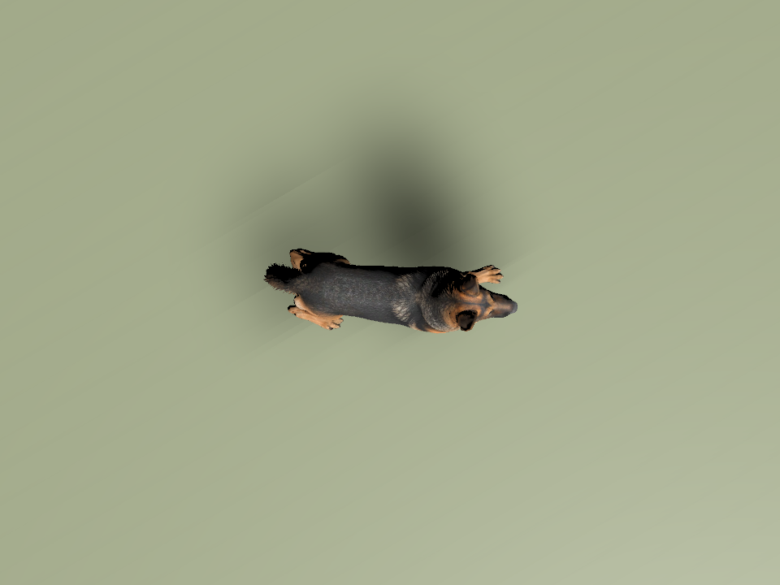
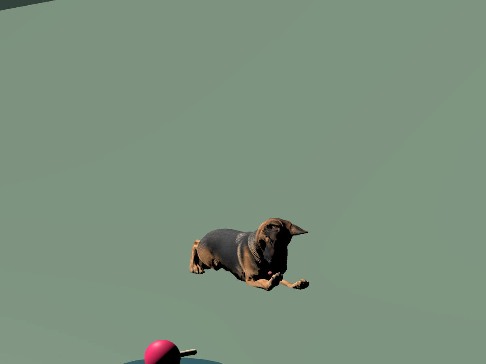
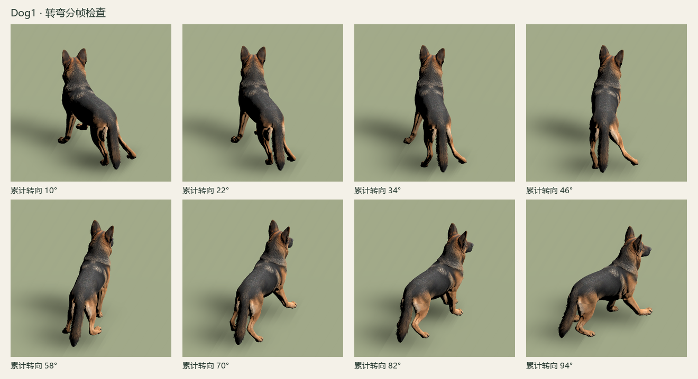
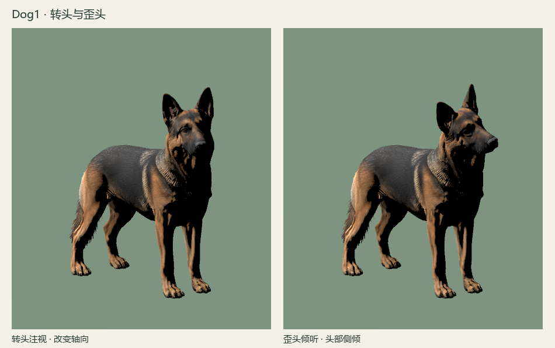

# Dog1 犬类骨架恢复与动作研究

## 转弯衔接与微动作

转弯步幅曾同时受朝向变化和路程影响，转得越急，四足就会频繁抬落。先把前进位移与转动合入同一套步态相位，再让根节点沿弧线移动、减轻转速对落脚频率的影响、按预计朝向安排接下来的几步。肩胸和骨盆分担转向，落脚目标保留左右分界。停步时让肩胸、尾部与身体起伏逐渐衰减。近距离注视由头颈完成，移动途中也可侧头短暂看向玩家。

桌面和头显都从「动作」页播放，可用「显示当前动作」查看自发行为。「转头注视」绕竖轴改变朝向，「歪头倾听」是沿头部前向侧倾的独立动作。预览歪头约 17°，进入、停留及回正分别缓动。日常互动的耳朵、头颈和胸部各有幅度限制。幅度和时长为游戏参数。[犬类歪头](https://link.springer.com/article/10.1007/s10071-021-01571-8) · [指示性交流](https://pmc.ncbi.nlm.nih.gov/articles/PMC6004278/) · [DogFACS 耳部行为](https://pmc.ncbi.nlm.nih.gov/articles/PMC11045831/) · [空气嗅闻](https://academic.oup.com/chemse/article/45/8/625/5907694)

以下是 `DogCompanion.MicroActions` 的动作目录。每项提供稳定 ID、本地化名称、时长和标签，执行入口为 `TryPlayMicroAction(id)`。执行器使用站姿、动作占用、耳骨和目标位置信息做限制。试玩的「看看我」允许已配置的模型从当前可用的 ID 中选一个，游戏负责骨骼动作和四足支撑。模型调用前后都从 Unity 读取有限的目标集合、距离、相对角度、视锥和射线遮挡。实际手柄追踪就绪时加入手部距离。模型收到这些结构化观测和当前输入，约定与熟练度仍由训练系统管理。[Unity 射线接口](https://docs.unity3d.com/2022.3/Documentation/ScriptReference/Physics.RaycastNonAlloc.html)

| ID | 动作 | 标签 |
| --- | --- | --- |
| `head_turn` | 转头注视 | `attention`, `yaw`, `orient`, `stationary` |
| `head_tilt` | 歪头倾听 | `attention`, `roll`, `listen`, `stationary` |
| `ear_perk` | 竖耳倾听 | `attention`, `ear`, `listen`, `stationary` |
| `ear_flick` | 单耳轻转 | `ear`, `orient`, `stationary` |
| `chest_lean` | 侧身探看 | `attention`, `chest`, `neck`, `stationary` |
| `air_sniff` | 抬鼻轻嗅 | `explore`, `nose`, `neck`, `stationary` |
| `gaze_exchange` | 看你再看玩具 | `attention`, `toy`, `gaze`, `stationary` |
| `soft_shake` | 轻摇头整理耳朵 | `ear`, `shake`, `self_care`, `stationary` |
| `groom_paw` | 伏身舔前爪 | `self_care`, `groom`, `paw`, `stationary` |
| `check_behind` | 侧头回望 | `attention`, `orient`, `neck`, `stationary` |
| `nose_to_floor` | 贴近地面闻嗅 | `explore`, `nose`, `floor`, `stationary` |

同一条双向转弯路线，落脚从最早 63 次降到上一版 49 次，本版 44 次。最大支撑脚滑移最早为 12.3 厘米，上一版 6.2 厘米，本版 11.6 厘米。另加连续弯道，累计转 157.6°，最大滑移 10.8 厘米。两条弯道路线都没有测到短于 5.5 厘米的摆步，停住后各有 33 个四足接触采样。直线慢走仍是 32 次落脚，小跑保持对角步序。[步态结果](qa/dog1-curved-walk.txt)

2026-11-25。基线：`release/v1.0` 与 `scene-setup`，保留本次已经完成的头显和语音功能。研究范围为犬类，不将人类步态或机器人控制直接当作狗的运动规律。

## 为什么看起来退步了

原版 `GermanShepherd.fbx`、蒙皮修形和尾部毛层资源与 v1.0 相同，骨架没有被删除。胸腰联动、四足接触、转弯提前补步、停步逐爪归位、走/小跑区分和动作预设也都还在。但新增模型适配之后，以下参数/实现覆盖了原来的调校：

- 以小腿高度重新估算步幅的代码也作用到了已经按米调好的原版德牧，导致步幅缩短和频繁落脚。
- 原版运动时的身体下沉高度被减小，前腿摆动额外混入了递爪求解。
- 关键点原来只通过桌面 IMGUI 绘制；立体相机启用时直接返回，因此戴头显看不到骨架。

恢复德牧的原始步幅尺度、加减速和身体高度，原版走路使用原有四肢接触求解，保留单独递爪时的关节控制。急转弯单独缩短步幅；直线慢走不再为了新犬种的比例而增加步频。保留肩胛、胸腰、骨盆、四足 IK、补步、毛层和蒙皮修形。关键点增加世界空间骨链和支持立体渲染的调试材质，仍读取真实动画骨骼。

## 骨架恢复阶段的动作范围

本次开发者「动作」页包含这些已有全身动作：坐下、趴下、转圈、抬右爪、伏身邀玩、邀玩后等待、低头闻嗅、轻扑、兴奋小跑、回应抚摸、休息、走到身边、叼玩具、叼棒棒糖，以及困惑回应。

预览不增加熟练度或奖励。先完成当前口令的反馈，再使用预览。轻扑、小跑仍检查场地净空，不会为了展示而穿过家具或玩家。正式口令仍通过原来的训练与记忆流程。反应动作 `refuse` 另纳入验证，共检查 15 种既有动作。

## 研究依据与本轮实现

| 资料 | 与本项目相关的发现 | 实现边界 |
| --- | --- | --- |
| [Sommese 等：An exploratory analysis of head-tilting in dogs](https://link.springer.com/article/10.1007/s10071-021-01571-8) | 在特定的熟悉物品名称任务中，歪头可能与处理有意义的声音、注意有关；研究不支持所有狗听到任何话都会歪头 | 说话/输入触发短暂注意窗口，歪头有进入、保持、退出和冷却；不会每句无限摆头。11°、2.2 秒、8 秒冷却是本项目的保守动画参数，不是论文给出的统一生理值 |
| [Worsley 与 O’Hara：犬与人的指示交流](https://pmc.ncbi.nlm.nih.gov/articles/PMC6004278/) | 日常交流包含在人与目标之间转头、悬爪、靠头等多种手势，同一目的可能使用多个手势 | 先加入静止时的短暂注视、颈部与头部分担转向、轻微胸部侧倾；保留四足接触。物体与人之间的目标交替注视留作后续上下文行为 |
| [Schaub 等：德牧骨盆和腰椎三维运动](https://www.frontiersin.org/journals/veterinary-science/articles/10.3389/fvets.2021.709966/full) | 个体和步间存在差异；被测腰椎相邻关节活动较小，骨盆与腰部存在协调，不能把整个背部做成软管式摆动 | 保留小幅胸腰/肩胯联动，不拉伸骨骼。游戏中的骨段不是每一节真实椎骨，不能逐段照抄论文的角度作为通用 ROM |
| [Byosiere 等：成年犬 play bow](https://www.sciencedirect.com/science/article/pii/S0376635716300286) | 犬间玩耍的伏身可在暂停后重新发起游戏；不能从单个姿态推断全部情绪 | 区分前低后高的伏身邀玩与直立合掌式“拜拜”。保留已有邀玩、等待回应、轻扑与短跑动作 |

大的注意手势保留给稳定站姿。普通探索途中允许短时小幅扭头。冲刺、转圈、闻嗅、取物等全身动作按各自节奏播放。侧身通过小幅胸部转动和原有足部求解完成。困惑回应使用歪头与立体问号，轻摇头留在单独的闲时动作里。

## Stay 可以学习到什么

用户指定：[Meta 产品页](https://www.meta.com/experiences/stay-forever-home/8870151916378062/)。也检查了[产品官网](https://stay-forever-home.com/)、[工作室官网](https://windupminds.com/)和[工作室的设计理念](https://windupminds.com/our-vision/)。公开页面强调陪伴、主动互动、个性与玩家回应；工作室公开提到了犬类认知作为设计参考。

本次没有找到公开的 Stay 动画源代码或可直接使用的骨架工程。不能从产品页证明它内部采用了 LLM、某一种状态机或某种 IK。可借鉴的是行为节奏：注意玩家、短暂回应、恢复安静、玩耍后等待回应，而不是持续播放大动作。Ember 是风格化的幻想动物，不能把其夸张造型的动作幅度当作真实犬类的解剖依据。本项目没有提取或复用 Stay 的模型、贴图或动画。

## 可继续利用的真实犬类资源

| 资源 | 有什么 | 适合下一步做什么 |
| --- | --- | --- |
| [RGBD-Dog / DynaDog，Bath 作者仓库](https://github.com/CAMERA-Bath/RGBD-Dog) | 犬类形状模型、可视化代码，数据说明包括已求解的骨架旋转、`skeleton.bvh`、中性网格和蒙皮权重；包含直走、小跑、跨杆、上下平台 | 对齐骨盆、胸、颈和四肢角色，再比较角度和触地曲线。作者要求通过申请获取学术数据；公司用途需联系作者，不能直接作为本游戏可分发商业动画 |
| [3DDogs，Surrey 官方数据页](https://cvssp.org/data/3DDogs/) | 真实犬类走路/小跑的光学动捕、RGBD、IMU 和压力垫资料 | 研究足部时序和背部运动。网页明确为非商业研究且禁止再分发，因此本轮未把数据打入游戏 |
| [StanfordExtra 作者仓库](https://github.com/benjiebob/StanfordExtra) | 犬图片的二维关键点和分割标注 | 帮助统一关键点命名与检查外形；它不是可直接播放的三维动作库 |

这些资料比直接找一个“人形骨架替代狗”更贴近需求。本轮先修复现有模型；未训练新的动作网络，也未声称已经用动捕数据重定向全部动画。

## 验证与实际限制

`DogGaitValidation.Run` 对同样的直线慢走、快速对角小跑、左右转弯和停步归位进行前后比较。慢走参考路线约 3.59 米；修改前 50 次落脚，恢复原步幅后为 32 次。落脚次数是四只脚的总和，不是某一只脚的步频。

`DogMotionRecoveryValidation.Run` 在隔离场景执行 15 种既有动作，逐帧检查骨骼本地位置、缩放和有限旋转；检查坐、趴、抬爪、伏身的支撑关系，执行两种实际取物，并测试注意时脚掌保持接触、根节点不被扭走。另检查 11 种可选犬种的主要骨骼角色是否齐备。模型映射通过不代表所有犬种的动画均已达到原版德牧的调校质量。

转弯过程中和站定后分别从后方、上方截图；15 个动作和歪头也分别渲染截图。可查看本目录配套的 QA 结果和 README 中的截图。

参数微调仍是程序化动画近似，没有完整肌肉、关节力矩和皮肤物理模拟。当前评价包括自动化的接触/骨长指标和截图检查；真实头显中的舒适性、连续运动观感和不同犬种的姿态仍需继续试玩评估。

## LLM 标签选择：仅记录方案，本轮不接入

理解用户要的是“观测上下文后选择回应”，不是永久固定的句子到动作映射。下一步分成：

1. 给现有动作写多标签描述，例如 `invite`：玩耍邀请、前低后高、需要空地、可被打断；`sniff`：探索、低唤醒度、短时低头。描述是能力与条件，不把单个动作等同于固定情绪。
2. 提供有限观测：玩家刚说的话、距离/视线、狗的食水与精力、附近可交互物、当前动作、短期事件和长期约定。
3. LLM 输出动作 ID、目标和可选的短动作串；只选择当前允许的动作，不输出自由关节坐标。
4. 现有执行层检查动作白名单、净空、姿势互斥、冷却与可达性，执行后报告结果，再决定反馈和记忆。遇到不适合动作时允许等待、注视或拒绝。

工作量主要在上下文筛选、动作标签质量、与反馈记忆的衔接，以及歧义/冲突情境测试；模型调用本身不是最难的部分。先把当前动作资产和姿态稳定性恢复，再开展这条线。
