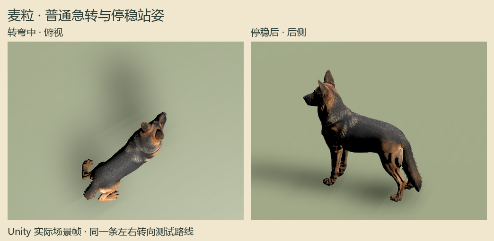

# 《城市里有一只狗》V1.0 发布说明

《城市里有一只狗》是一个 Unity 养犬与训犬模拟器。玩家领养德国牧羊犬麦粒，在城市里照顾它、带它散步，并通过练习和表扬教会它日常动作与特定情境下的回应。V1.0 对应 `release/v1.0`，Unity Player 版本为 `1.0.0`。



## 这一版能玩什么

| 体验 | 内容 |
| --- | --- |
| Windows 桌面 | 从公寓开始，完成五章领养照护和训练目标。可以喂食、换水、陪玩、遛弯、拾便和休息。用小骨头解锁街区公园，达到成长条件后解锁露台小屋。章节结束后可继续生活。 |
| 文字与语音训犬 | 初次口令可能需要重复。动作完成后及时表扬，麦粒会记住动作熟练度、命名的动作串和约定。可以教它在听到「我心情不好」时叼回指定的游戏道具。 |
| 犬只自主行为 | 麦粒会闻嗅、邀请玩家陪玩、找玩具或休息。在开阔的公园里，它有时会沿短弧线小跑，路径受净空和玩家位置约束。 |
| Quest Link PCVR | Windows 上公寓里的陪伴与训练体验，提供空间手记、双手柄射线、移动与分段转向、抚摸和按键语音。五章照护流程在桌面场景中体验。 |

## 启动与第一次训练

- **桌面。** 运行 `Builds/CityDogVoice/CityDog.exe`，选择「回家见麦粒」或「继续生活」。左键操作菜单，按住鼠标右键转动视角，用 WASD 移动。按住 `V` 说话、松开后转写，也可在说话页键入。`Esc` 可取消正在进行的录音，平时打开暂停菜单。
- **Quest 3。** 在 Windows 的 Meta Horizon Link 中设为活动 OpenXR Runtime，进入 Quest Link 后运行 `Builds/CityDogPCVR/CityDogPCVR.exe`。左摇杆移动，右摇杆分段转向。右手 `A` 按住讲话、松开转写，`B` 取消。将手柄射线对准手记，再扣下并松开扳机来选按钮。PC 窗口提供 `F8` 录音切换、`F9` 重连 OpenXR 和文字调试输入。
- **本地中文语音。** 首次使用时，在可执行文件旁的 `SpeechService` 目录用 PowerShell 运行 `./Setup.ps1`。需要 Python 3.10–3.12、网络和目录写权限，用于安装依赖和下载 Whisper base。Python 未加入 `PATH` 时传入 `-PythonPath`。安装后录音转写可离线运行。使用本机麦克风前，确认 Windows 选中了对应的输入设备。
- **Unity 编辑器。** 用 Unity `2022.3.62f3` 打开工程，进入 `Assets/Scenes/Dog1.unity`（桌面）或 `Assets/Scenes/Dog2.unity`（PCVR），点击 Play。构建时保留可执行文件旁的数据目录、DLL、`SpeechService` 和 `ATTRIBUTION.md`。

1. 说或输入「坐下」。第一次若犹豫，再试一次，完成后说「真棒」或点击表扬。
2. 输入「晚安：坐下、抬右爪、拜一拜」。等麦粒完成动作串后表扬，只说「晚安」即可复现。
3. 输入「我心情不好的时候，给我叼来一颗棒棒糖」。等麦粒带回游戏道具后表扬。退出并重开，再输入「我心情不好」，确认它能取回道具。已教过的同名动作串有优先权，建议用新存档做这个例子。
4. 在桌面设置中开启骨骼关键点，观察慢走时四爪依次落地、原地转圈时逐爪换位、停稳时恢复站姿。

## 麦粒怎样学习和移动

`DogAgent` 解释当前话语并维护最近尝试、动作结果及可表扬窗口。动作完成并获得表扬后，熟练度和情境约定写入 `dog-memory.json`，命名动作串写入 `dog-routine.json`，桌面照护、成长和地点进度写入 `dog-life.json`。这些文件位于 Unity 的 `Application.persistentDataPath`。桌面和 PCVR 共用训练记忆，照护进度由桌面场景推进。

文字输入和本机 `faster-whisper` 转写进入同一套指令逻辑。离线规则覆盖既定训练流程。可选模型可从设置中启用，使用支持 JSON 输出的 OpenAI 兼容接口。仅在需要模型判定时，会把当前一句和有限的训练摘要发送到用户配置的服务；语音音频由本机回环服务处理。模型输出为结构化意图，Unity 按白名单校验动作、道具和顺序，动作串限两至三步且最多取物一次，执行失败时中断。

`DogCompanion` 用现有德牧骨架上的头、颈、胸、腰、骨盆、四肢、足趾及尾部关键点驱动预设和程序化动作。关键点模式直接读取虚拟角色骨架。四拍慢走和对角小跑分别安排落脚，转弯和停步后逐爪补步；轻扑检查前方净空，骨骼长度在动作中保持固定。肩胯、关节蒙皮修形和尾部毛层随姿态更新。

## 构建与复验

安装 Unity `2022.3.62f3` 的 Windows Build Support。退出正在使用此工程的 Unity Editor，再从项目根目录执行以下 PowerShell。把 `$unity` 改为本机 Editor 路径。每项验证使用独立的空测试存档目录。

```powershell
$unity = 'C:\Program Files\Unity\Hub\Editor\2022.3.62f3\Editor\Unity.exe'
$project = (Get-Location).Path
$qa = Join-Path $project ('Builds\ReleaseQA-' + [guid]::NewGuid().ToString('N'))
New-Item -ItemType Directory -Path $qa | Out-Null

function Invoke-CityDogUnity($method, $logName) {
    $log = Join-Path $qa ($logName + '.log')
    $arguments = @('-batchmode', '-projectPath', ('"{0}"' -f $project),
        '-executeMethod', $method, '-logFile', ('"{0}"' -f $log))
    $process = Start-Process -FilePath $unity -ArgumentList $arguments `
        -WindowStyle Hidden -Wait -PassThru
    if ($process.ExitCode -ne 0) { throw "$method failed. See $log" }
}

Invoke-CityDogUnity 'Dog1DemoValidation.BuildWindows' 'windows-build'
Invoke-CityDogUnity 'Dog1DemoValidation.BuildPcVr' 'pcvr-build'

$checks = @('DogLifeValidation.Run', 'DogGaitValidation.Run',
    'DogMotionValidation.Run', 'DogPlayValidation.Run',
    'DogTailValidation.Run', 'DogPlayAgentValidation.Run', 'Dog2AgentValidation.Run')
$previousSaves = $env:KEEP_A_DOG_TEST_SAVES
try {
    foreach ($check in $checks) {
        $env:KEEP_A_DOG_TEST_SAVES = Join-Path $qa ($check + '-saves')
        New-Item -ItemType Directory -Path $env:KEEP_A_DOG_TEST_SAVES | Out-Null
        Invoke-CityDogUnity $check $check
    }
} finally {
    $env:KEEP_A_DOG_TEST_SAVES = $previousSaves
}
```

确认两个构建日志均出现 `KEEP_A_DOG_BUILD: Succeeded`。Play 验证会自行退出；日志分别使用 `CITY_DOG_OK`、`DOG_GAIT_OK`、`DOG_MOTION_V2_OK`、`DOG_PLAY_VALIDATION_OK`、`DOG_TAIL_VALIDATION_OK`、`DOG_PLAY_AGENT_OK` 和 `CITY_DOG_XR_AGENT_OK` 标记通过。视频和截图复验可按需要为步态、动作和尾部测试配置 `CITY_DOG_GAIT_CAPTURES`、`CITY_DOG_MOTION_CAPTURES`、`CITY_DOG_PLAY_CAPTURES` 或 `CITY_DOG_TAIL_CAPTURES` 指向可写目录。

## 已验证与已知限制

- 发布前的 Windows 构建与 Unity 场景回归覆盖了照护和地点解锁、训练记忆重载、慢走和小跑、转圈和停步、轻扑及净空拦截。步态脚本记录了慢走 26 次落地均未出现对角同步，小跑 15 次落地中有 14 次对角同步；转圈样本为 359.99°，170 帧内无爪子跨过身体侧线。这些数据来自固定测试路线和当前模型。
- 直线慢走和小跑在起步首秒仍可见爪底滑移，固定路线记录的单次支撑最大滑移约为 4.4 与 9.2 厘米。公园短冲目前采用对角小跑。全速疾驰在后续制作范围。
- 本机 Whisper 已用合成中文 WAV 验证转写。Unity 自动回归使用模拟转写和模型响应检查代理流程、动作白名单、空间射线与手柄配置。实际 Quest 双眼画面、实体按键、麦克风和帧率需要连设备验收，远端模型效果依服务配置而异。
- Windows PCVR 使用 Quest Link。Android 一体机包、Steam 商店审核和发布属于后续阶段。

## 署名与依赖

- 德牧模型和原始贴图由 Francesco Saviano / 3dskillup.art 提供，采用 CC BY 4.0。项目修改了材质、朝向和比例，加入程序化骨骼动画、姿态修形及尾部毛层。分发时保留 `ATTRIBUTION.md`，仓库内位于 `Assets/wjy_workspace/Dog1/ThirdParty/ATTRIBUTION.md`。 [模型来源](https://3dskillup.art/free-assets/german-shepherd/) · [CC BY 4.0](https://creativecommons.org/licenses/by/4.0/)
- 语音安装脚本通过 pip 安装 `faster-whisper` 与配套依赖，并下载 SYSTRAN 转换的 Whisper base。`faster-whisper` 和该模型标注为 MIT。Python 环境和模型缓存由本机安装生成。 [faster-whisper 许可](https://github.com/SYSTRAN/faster-whisper/blob/v1.2.1/LICENSE) · [Whisper base 模型卡](https://huggingface.co/Systran/faster-whisper-base)
