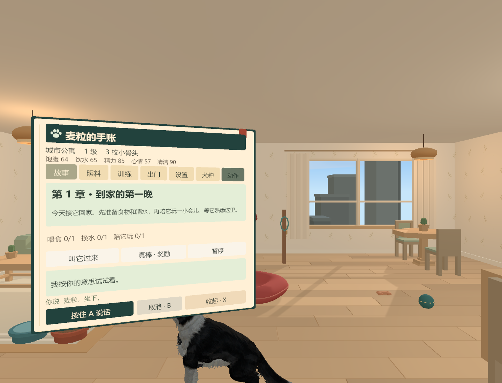

# 玩家体验走查：休息、邀玩与行为结果

日期：2026-11-26

本轮已完成重点问题修复、Unity 场景回归及桌面实际操作。下文区分模拟模型、真实语音服务和实体设备的覆盖范围。

这次走查从玩家的实际表达出发：狗已经趴下或回窝休息，游戏就应记录休息；已经取回玩具，就应记录陪玩。同一种活动通过语音、按钮、故事选项或头显手账发起时，结果应一致。任务进度、体力变化与小骨头奖励也应各自说明清楚。

## 本次调整

| 玩家会遇到的情况 | 统一后的规则与预期反馈 | 复验状态 |
| --- | --- | --- |
| 说“趴一会儿”“歇会儿” | 模型选择已注册的趴下或休息动作，实际成功完成后都计入休息，恢复体力并推进适用的休息任务。 | 已验证 |
| 让它回狗屋或去软垫歇一会儿 | 走到休息点并完成休息后，使用同一套恢复与任务记账；不能只有动画、没有生活系统结果。 | 已验证 |
| 点击“陪它休息”或接受安静陪伴的故事选项 | 与语音发起的真实休息保持一致，完成后记录陪伴行为。 | 已验证 |
| 狗累了，自己找地方趴下 | 自主休息恢复体力；不会自动替玩家完成“陪它休息”，也不会发放玩家的经验和小骨头。 | 已验证 |
| 短时间内再次休息、陪玩或完成其他照护 | 真实活动仍能产生应有的状态变化和任务记录；奖励冷却期间不会重复发放经验和小骨头。不能因为奖励没冷却就把已完成的活动说成没有发生。 | 已验证 |
| 点击旧称“拜一拜”的动作 | 玩家界面统一称“伏身邀玩”。保留已有前身伏低、后躯抬高的骨架动作及旧口令、旧存档兼容。 | 已验证 |
| 狗通过语音指令或自主行为伏身邀玩 | `bow` 与 `invite` 成功后都打开“陪它玩球／陪它安静一会儿／等一会儿再玩”三个选项，并停留、自然看向主人约 5.5 秒。命令结束恢复自由活动时，不能立刻抹掉这次等待。 | 已验证 |
| 使用系统提供的动作串教学按钮 | 新预设改为“打招呼”，避免把坐下、抬爪和邀玩称作“晚安”。玩家以前已教会的“晚安”命名动作串继续兼容。 | 已验证 |
| 用语音让狗叼回玩具球 | 实际取回成功后，除动作与训练反馈外，也计入相应的陪玩活动；未取回不记成功。 | 已验证 |
| 明确教它“我心情不好时，你就……” | 模型可输出 `learningCondition=owner_sad`，实际练习成功后还须表扬才保存约定；单纯说“我现在难过”不会创建教学。近期对话文本也提供给模型。 | 已验证 |
| 狗叼起玩偶，却在回程中途停下 | 回程目标必须同时满足公寓可走区域和主人身边的原有距离限制；不放宽交付距离、不瞬移。玩具接触点使用碰撞体表面，避免模型中心偏移导致明明够到却叼不起。 | 已验证 |
| 在 VR 手账里开始遛弯后改变主意 | 原遛弯按钮变为“取消这次遛弯”，遛弯期间仍可使用；取消会清除路标和跟随状态，不发放完成奖励。 | 已验证 |
| 动作被打断、目标失效或没有真正开始 | 依据本次动作的完成标记判断结果，不沿用上一次成功标记，不把跳过的动作写成完成，也不据此推进任务或发奖。 | 已验证 |

## 复验时按玩家流程检查

1. **不同方式都能休息。** 分别通过自由语音、训练按钮、照护按钮、狗屋、软垫和故事选项发起；核对动作、体力变化和任务进度。再让狗自主休息，确认只恢复自身状态。
2. **行为完成与发奖分开。** 在奖励冷却期间重复完成活动，确认活动仍有效、任务按规则记录，经验和小骨头没有重复增加；失败或取消的活动不记成功。
3. **邀玩形成可回应的互动。** 从桌面、语音和模拟 VR 入口触发伏身邀玩，确认三个回应选项可用、模型回复被保留、狗会自然等待。分别选择陪玩、安静和稍后，检查结果一致。
4. **训练有上下文和可验证的记忆。** 练习“打招呼”，完成并表扬后再调用；加载已有“晚安”存档确认兼容。建立一个条件约定，确认奖励后能够唤回，并检查模型接收的近期上下文。
5. **遛弯可以退出。** 在 VR 手账开始遛弯，不走到路标，使用取消按钮；检查路标、跟随、任务和奖励。正常走完则核对真实完成状态。
6. **故障不会伪装成功。** 在等待、执行和取物过程中制造可控的过期、阻塞或目标不可用条件，核对界面反馈、完成标记和生活系统记录。

## 测试范围与结果记录

本轮验证目标包括桌面操作和 Unity 中的 VR 交互模拟。模拟通过只能证明代码入口、按钮、状态和动作链路一致；**尚无实体头显佩戴测试的设备证据**，不能据此认定真实手柄、双眼显示、空间舒适度或头显麦克风已通过。

| 验证项 | 结果 | 证据 |
| --- | --- | --- |
| 项目编译与集成 | 通过 | 原项目运行时编译；完整 Unity 测试项目使用相同运行时源码 |
| 休息恢复、任务与奖励冷却 | 通过 | `DogRestLifeValidation.Run`：31 项；`Dog1ExperienceValidation.Run`：7 种真实休息入口；`RunRestFlows`：8 项 |
| 伏身邀玩与三种回应 | 通过 | Experience 场景检查邀请回应及稍后选项；PlayAgent 回归检查行为执行 |
| 语音取物的陪玩记账 | 通过 | `Dog1ExperienceValidation.RunInteractionTail`：23 项，含真实取球、玩偶回程、任务与奖励 |
| 条件教学与短期上下文 | 通过 | `RunConditional`：12 项；`DogLearningConditionValidation.Run`：59 项；实际取物、表扬、存档再加载后召回 |
| 模拟 VR 遛弯取消 | 通过 | 交互尾段检查按钮、路标、跟随取消以及没有完成奖励 |
| 非法计划、队列过期与场景阻塞 | 通过 | Parser：34 项；Controller、Queue、Conversation 回归通过，保留 3 个待执行槽位和 5 秒窗口 |
| 动作未开始却沿用上次成功标记 | 通过，74 项 | `DogActionCompletionValidation.Run`：不可执行或已有动作时清除旧结果；缺少本次完成标记不能计任务、奖励或显示成功 |
| 桌面玩家流程试玩 | 已操作 | 原 Unity 窗口点击去软垫休息：体力从 0 恢复到约 35，休息记录增加一次；喂食、换水已实际点击验证 |
| 固定中文 WAV → 语音识别 → 模型 → 实际坐下 | 通过（本地模型桩） | 严格 Headset Graphics 回归：真实本机 Whisper 转写，模型端使用受控 JSON 回包；断言无模型错误且实际完成坐下 |
| 真实 DeepSeek 语义与协议联调 | 通过，7/7 | 使用当前 Agent 与解析代码；验证自然回复、动作 ID、休息目标与是否创建条件教学。此专项不包含模型直接驱动场景动画 |
| 实体头显佩戴测试 | 未实测 | 本轮没有设备测试证据 |

### 兼容回归范围

以下九套入口均通过：`ControllerParserValidation.Run`、`DogLearningConditionValidation.Run`、`Dog1ControllerValidation.Run`、`DogLifeValidation.Run`、`Dog1CommandQueueValidation.Run`、`Dog1ConversationValidation.Run`、`DogPlayAgentValidation.Run`、`Dog1HeadsetValidation.Run`、`Dog1PhysicalPropsValidation.Run`。

覆盖照护与五章任务、场景解锁和存档加载、交互玩具、取物交付、动作串、条件记忆、暂停、语音取消、模型故障、射线按钮、无头显时的桌面兼容入口。头显回归使用 Unity 图形渲染和控制器射线模拟，语音使用固定合成中文 WAV；不能代替真人口音、嘈杂房间或 Quest 实机测试。没有在本轮重新打包旧的独立试玩程序。

### 测试中修正的问题

- 初次玩偶教学因回程目标被地面边界截断而失败，修复合法接近点后重跑真实取物、表扬、存档、召回流程通过，交付距离仍使用原阈值。
- 条件教学解析首次发现 Unity 把 JSON 字符串字段的 `null` 变成空串。现在从原始顶层字段区分省略、`null`、非法空串和重复字段，59 项严格校验重跑通过。
- 旧头显测试只检查字幕包含“坐”，不能证明模型与执行成功。现补上模型来源、无请求错误和实际坐下的断言；修正测试服务路由后重新截图，成功界面不再夹带 HTTP 400。
- 模型计划过期或容量不足时，主要反馈明确说明未执行，不再只在调试记录写取消、界面却仍保留承诺执行的回复。
- 取物、靠近及玩耍动作在本次未开始时会清除旧成功标记；记账与故事反馈还须核对本次动作的完成身份。单独补充 74 项回归通过，失败的陪玩和遛弯不会误加任务或改变生活状态。

### 真实模型的实际选择

| 玩家表达 | 本轮真实 DeepSeek 返回与后端结果 |
| --- | --- |
| “趴一会儿，歇歇吧” | `rest → cushion`；未指定地点，选择软垫休息合理 |
| “就在原地趴一会儿” | `rest → none` |
| “回你的小狗屋里歇一会儿” | `rest → house` |
| “去软垫上趴着休息一下” | `rest → cushion` |
| 旧口令“拜一拜” | `bow → none`，对应伏身邀玩 |
| “以后我难过时，请把毛绒玩偶叼给我，我们先练一次” | `fetch_lollipop`，创建 `owner_sad` 条件练习；实际完成并表扬才长期保存 |
| “我现在有点难过，想和你待一会儿” | 选择 `come`，不创建新的条件教学 |

模型选对动作、动物是否熟练、动作是否实际完成是三个不同检查点。新存档中未学会的基础口令仍可能先疑惑，重复练习后尝试；调试记录会保留模型选中的动作，不能把这种情况解释成模型没有映射。测试中首次网络请求发生 TLS 连接错误，安全重试后七例全部通过，没有关闭证书校验。

本页只覆盖本轮重点修复及列出的兼容回归，不能替代所有场景、犬种、设备和长时间游玩的完整验收。
