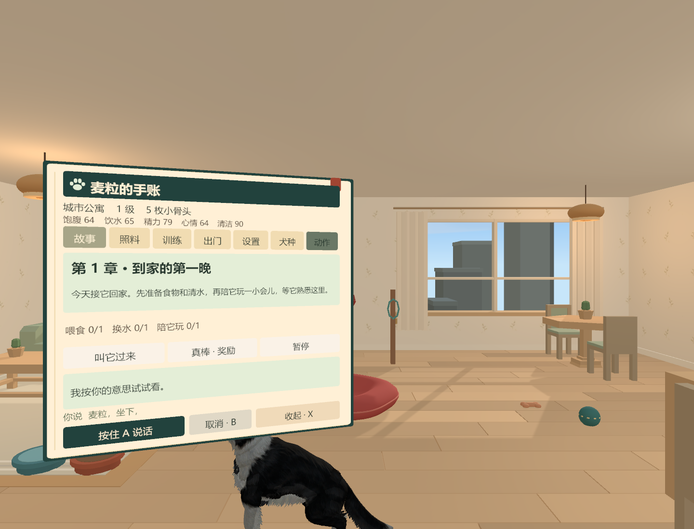

# douga-3.0 与 main 的本地整合

日期：2026-11-26。基于 `douga-3.0` 的 `6b41a34`，迁入 `main` 的 `0deb016` 中适合共用的交互与训练设计。本轮只在本地整合，不推送 GitHub。

## 保留的基础

- 自由语音和文字继续交给 DeepSeek，保持 `reply / decision / actions[]` 协议、动态动作目录、逐步执行前校验，以及非法计划不执行。
- 保留最多三个待执行项目、五秒等待窗口、同一句动作串按顺序执行，以及当前动作完成后再切换。
- 保留语音逐轮记录、断线重试、Windows 本机加密凭据、明确的鉴权与连接错误。
- 保留短期对话文本、长期条件教学、实际完成后表扬保存，以及全部骨架、微动作与开发者预览。
- 保留休息记账、奖励冷却只限制奖励、取物回程可达点、本次完成标记和 VR 遛弯取消。

## 合入的交互

玩具继续支持握把抓取，新增扳机近手抓取；扳机拿起、持有和松开时会屏蔽同一只手的菜单选择，避免一边拿球一边误按按钮。暂停或追踪重置后，释放帧仍由抓取逻辑消费。

食盆、水盆变成可抓取刚体。提起时保持水平，松手后直立放下；碗不接收玩具的水平投掷速度。狗的探索、照护和模型观察都读取碗的实际位置。当前场景内搬动有效，碗的位置尚未写入长期场景存档。

模型动作目录增加 `eat` 和 `drink`，目标均为 `none`。空碗、手持碗、仍在移动的碗、位置过高或不可达的碗，都不会被标成可执行。狗接近后再次检查碗的位置和内容，不能在旧位置吃饭。照护按钮会先添粮／水，再执行同一个消费过程；模型指令不会凭空填满空碗。需求上限沿用生活系统规则。

取球保留原有公寓边界修复和碰撞体接触点，增加短暂等球落稳，以及朝主人方向放球。**扔出后自动追取仍未实现**；落稳后可以用语音、训练或陪玩入口发起叼回。

## 六项概率训练

坐下、趴下、抬右爪、转圈、过来、叼球均从 40% 开始。抽中后还必须实际完成动作，成功率才增加 10%，最高 90%。未抽中或实际失败会尝试模型选定、仍可用的安全微动作，并显示本次失败回复，不记成功、不发完成奖励。

实际成功后开启十二秒表扬窗口。语音以开始录音的时刻判断是否在窗口内，避免转写耗时吃掉回应时间。模型判断是否为真诚表扬，后端核对本次成功记录；确认后再增加 10% 并摇尾，同一次成功只能强化一次。可信的表扬按钮也可以确认。训练进度独立保存，读写失败显示在设置页，主文件损坏时可恢复备份。

普通陪伴、休息、吃喝和多动作计划不抽签。模型明确选择单项练习时才附加可选 `training` 字段：

```json
{
  "reply": "我试着坐下来，你看看。",
  "decision": "act",
  "actions": [{"id": "sit", "target": "none"}],
  "training": {
    "mode": "practice",
    "alternative": {"id": "refuse", "target": "none"},
    "failureReply": "这次没跟上，我们再练一次吧。"
  }
}
```

表扬使用 `decision=reply`、空动作数组及 `training={"mode":"praise","sincere":true}`。省略 `training`、`null` 或 `mode=none` 与旧协议兼容。错类型、重复字段、额外字段、非安全备选、练习动作不在六技能内或同次混入多个练习动作，都会保留文字、拒绝计划。明确点击某技能后，模型返回别的技能或漏掉练习标记也不能执行。

概率抽样在 Unity 执行端进行，语音服务继续只负责转写。本次没有引入 main 的第二套模型协议、四十五秒等待或额外的语音服务抽签依赖。

## 验证记录

运行时静态编译通过。以下表格在最终集成后填写；模拟通过不代表实体 Quest 手柄、双眼显示或头显麦克风已经验收。

| 项目 | 状态 | 证据 |
| --- | --- | --- |
| 训练协议、类型与备选安全、存档备份 | 通过，160 项 | `DogTrainingProtocolValidation.Run` |
| 统一动作入口、概率练习、表扬、移动碗实际吃喝 | 通过，71 项 | `Dog1IntegrationValidation.Run`，包含低头中断、旧试练串线边界 |
| 指定训练按钮与错误模型回包 | 通过，9 项 | `Dog1IntegrationValidation.RunTrainingGuards` |
| 搬碗、扳机与 UI 射线互斥 | 通过 | `Dog1PhysicalPropsValidation.Run` |
| 旧队列、控制器、休息与条件教学 | 通过 | Queue、Controller、RestFlows（8 项）、LearningCondition（59 项） |
| 表扬窗口内开始说话、转写晚到 | 通过，7 项 | `Dog1IntegrationValidation.RunDelayedPraise` |
| Unity 图形与固定中文 WAV | 通过 | `Dog1HeadsetValidation.Run`，实际射线练习、表扬，再经 Whisper 和模型桩完成坐下 |
| 真实 DeepSeek 新训练协议 | 通过，6/6 | 明确练习、普通坐下、真诚表扬、否定表扬、回屋休息、持碗拒绝；临时会话凭据不写入源码 |
| 实体 Quest | 未实测 | 本轮不作硬件通过声明 |

十套重点回归均已通过。Headset 验证使用确定成功的抽样来验证正向玩家流程，随机失败另用固定失败抽样检查；不能把未表扬保存的旧技能当作已学会。测试还发现按钮可用状态每 0.2 秒刷新，射线测试现在先等待页面刷新，再真实点击，不直接更改按钮状态。

真实模型首轮对普通“坐下”漏掉了练习标记。已明确 `practiceRequested=false` 只表示没有点击训练按钮，并补上普通口令示例；重测六例全部通过。修复仍由模型理解语义，没有加入句中关键词兜底。这六例检查模型输出与协议解析，动作实际执行由上述 Unity 场景回归验证。



本轮验证只修改隔离测试存档，不重置玩家自己的生活进度。原 Windows 独立试玩包尚未重新构建，最终本地源码可从 Dog1 场景运行。
